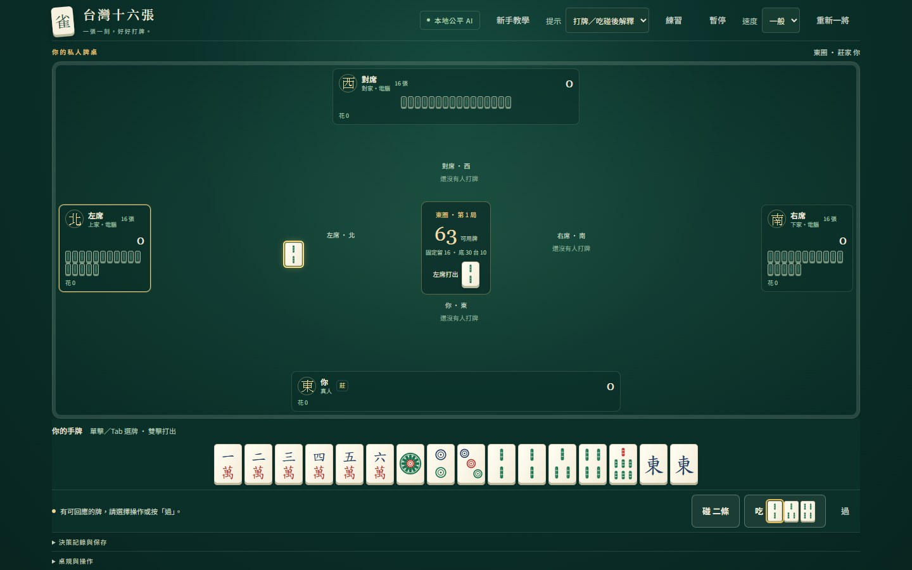
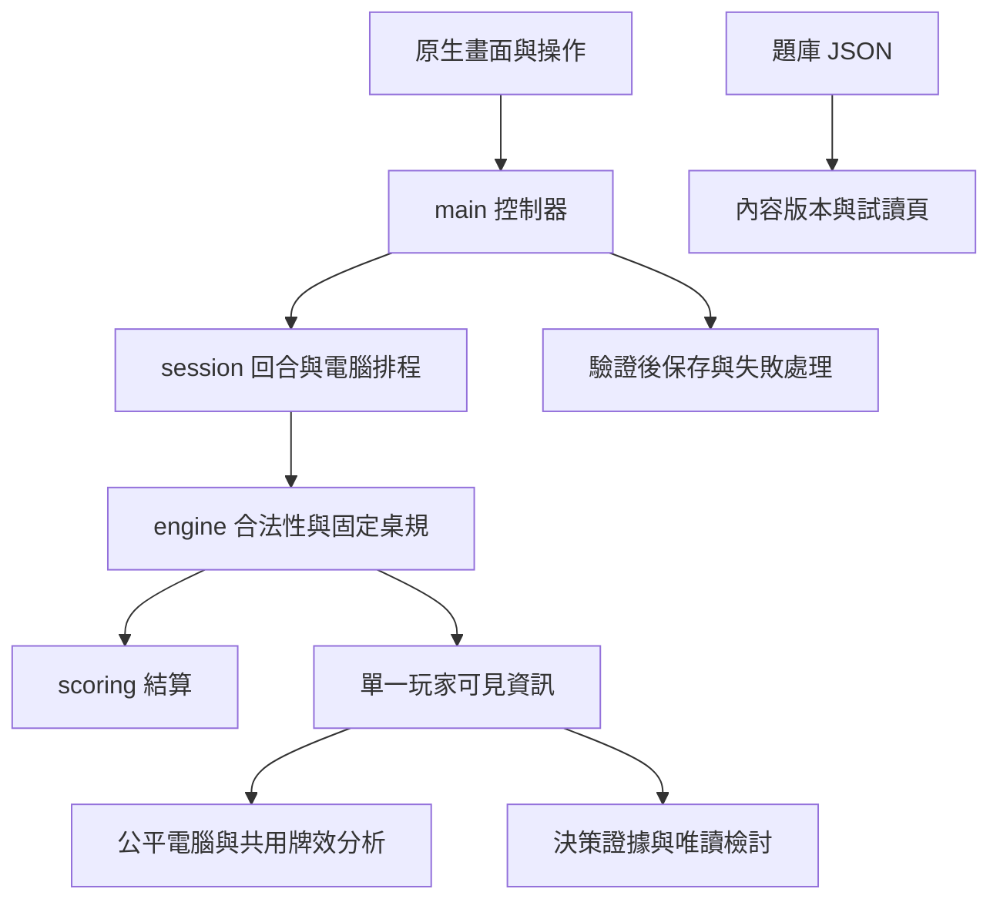

# 從零到一百的麻將路｜台灣十六張麻將學習與決策練習

一款可直接在瀏覽器玩的台灣十六張麻將產品：一位真人與三位本地電腦，搭配牌效練習、打牌與吃碰回應後的解釋、局後檢討。採明確桌規，讓合法行牌、資訊公平與資料保存都能驗證。

**[立即遊玩](https://zhai2liu.github.io/taiwan-mahjong/) · [從零入門](https://zhai2liu.github.io/taiwan-mahjong/learn.html) · [決策題試讀](https://zhai2liu.github.io/taiwan-mahjong/training.html) · [開發與維護入口](outputs/taiwan-mahjong/README.md)**

此專案使用 AI 協作開發。開發工具與遊戲內電腦是不同概念：遊戲內使用本地策略，無需模型 API、登入或後端。

## 為什麼做這個專案

台灣麻將有豐富的桌規例外，玩家也容易把「手牌更接近胡牌」誤當成「這張牌整體最安全」。本案將完整對戰與可核對的決策說明結合，讓玩家先作選擇，再查看候選差異與適用限制。

產品提供新手與進階兩條學習路線；八課入門採固定可操作牌例，既有對戰與練習可直接使用。各版本驗收與發布狀態見[現行交接](outputs/taiwan-mahjong/HANDOFF.md)，真人理解與成效仍待驗。

| 狀態 | 範圍 |
|---|---|
| **已上線** | 完整對戰、台型與台數明細、本機續局、純牌效練習、六步操作導覽、即時輔助／打牌與吃碰後解釋、局後最多三筆檢討與同類練習入口 |
| **可試讀原型** | 九道情境題，四類能力導引、自動本機保存續答；先作答再看推導，可重練本題、寫自己的理由、另存本機備份，未存時提醒離頁；不計整體牌技分數 |
| **入門試用版** | 第1–8課，從認牌、摸打與組牌，到吃碰槓、聽胡過水、結算及完整示例；第7–8課可手動保存段落、暫停續學，另有實桌附錄；限定驗收與發布見HANDOFF |
| **後續工作** | 依實際卡點修訂、真人理解與實機回饋，題族／難度校準及正式評量；工程回歸不等於學習成效 |
| **離線研究** | 人性化 AI、牌風與阻莊；現行正式電腦策略尚未整合人格 |

固定桌規為 [TW16-CLASSIC-v1](outputs/taiwan-mahjong-m0/RULES.md)，是本專案選定的台灣十六張變體。桌面優先；窄畫面與鍵盤已有驗收，指定手機／Safari 的支援承諾待實機驗證。

## 兩分鐘體驗路徑

1. 首頁開「操作說明」，查看 134 遇上家 2 的兩種吃法；完整入門另選「新手課程（第1–8課）」。
2. 開「純練習模式」，選一張牌，查看離聽牌多遠及有效進牌，再打牌／摸下一張。
3. 開「決策題試讀」，作答 E01 後看答案與推導，確認自己的捨牌理由。

完整對戰可選「打牌／吃碰後解釋」；打牌後或吃碰回應完成仲裁後暫停比較，關閉後自行繼續。結算可看本局少量決策檢討與同類練習入口。教學與決策題已撤下回饋填寫、回饋下載及交回引導；本機作答保存與備份供玩家自己使用。



上圖使用合成牌例，記錄2026-10-20版本bdb63df，不代表真人學習成效。請依上方體驗路徑直接操作現行網站；[舊版展示素材](outputs/taiwan-mahjong-showcase/README.md)只供歷史追溯，展示短片後續工作已取消。最新驗證以HANDOFF為準。

## 架構與資訊邊界



引擎決定合法動作；畫面和 AI 使用引擎提供的選項。電腦與提示取得自家手牌及公開資訊，排除其他玩家手牌、牌牆順序與洗牌種子。檢討使用當時快照，結算畫面呈現已結算結果。

## 三個工程案例

### 1. 相同公開資訊，實際風險可能不同

**問題：**玩家看不到對手的暗牌，不能從一個選牌分數推得真實放槍率。

**方案：**將確定計算、條件安全證明與目標偏好區分，缺充分證據時顯示未知；以兩個公開資訊完全相同、但能胡的牌不同的局面檢查資訊邊界。

**取捨與驗證：**能說明已知條件與局部安全範圍，保留不確定性。普通放槍安全不保證阻止莊家自摸或流局續莊。

[案例與推導](outputs/taiwan-mahjong/L1A-EVIDENCE-VALIDATION.md) · [可執行反例](outputs/taiwan-mahjong/test/evidence-boundaries.test.mjs) · [證據實作](outputs/taiwan-mahjong/src/decision-evidence.ts)

### 2. 失敗時也要保住牌局與付款完整性

**問題：**瀏覽器保存可能失敗，多個分頁可能競爭，重載結算也可能造成重複付款。

**方案：**載入嚴格驗證，壞檔保留；保存失敗提供重試，跨頁衝突停止覆寫。真人有效動作後先保存牌局，再記錄獨立的決策快照；重開結算不重新執行付款。

**取捨與驗證：**使用瀏覽器本機存檔，保持可離線計算；換來源或清除瀏覽器資料不保證復原。控制器測試注入配額／權限錯誤，另有跨頁及實際操作驗收。

[保存接線與故障證據](outputs/taiwan-mahjong/L2A3-RECORDING-VALIDATION.md) · [控制器測試](outputs/taiwan-mahjong/test/controller.test.mjs) · [結算完整性測試](outputs/taiwan-mahjong/test/settlement-integrity.test.mjs)

### 3. 將試玩回饋變成可重現的改善

**問題：**使用者回報手牌 134 遇上家 2 時，看不到 13 吃法，並指出額外打牌按鈕、海底位置與結算捲動影響操作。

**方案：**先驗證三花色、四座位的兩種吃法及禁打限制；操作調整為選牌／雙擊打牌，打出的牌集中於桌面中央，結算改用視窗呈現。

**取捨與驗證：**原描述未能重現引擎缺少吃法的錯誤，因此補足規則回歸與畫面驗收；保留鍵盤操作與焦點，沒有以未量測數據宣稱效率提升百分比。

[吃牌專項](outputs/taiwan-mahjong/M3.1-CHI-VALIDATION.md) · [操作與美術驗收](outputs/taiwan-mahjong/M3.1-VALIDATION.md) · [吃牌測試](outputs/taiwan-mahjong/test/chi.test.mjs)

## 專案擁有者與 AI 協作

- **專案擁有者：**提出台灣麻將、靜態網頁與公平陪打需求；決定玩法／學習方向，提供實際操作與美術回饋，決定研究是否進入正式版本。
- **AI 協助：**整理規格、實作與修正程式、測試、發布核對、文件和交接。現行由Codex規劃及驗收、Claude Code實作與自測；各階段的實際分工保留於驗收紀錄。
- **可追溯方式：**保留實際 Git 作者及階段驗收，以上案例可連到程式與測試。本人程式熟練程度、獨立修改能力與手寫比例不由 AI 推定。

上述需求、方向、實際操作回饋與AI協作分工，已於2026-10-17由專案擁有者確認符合實際；[確認紀錄](outputs/taiwan-mahjong/S51-DEMO-VALIDATION.md)不推定個人技能或手寫比例。

2026-10-21起依使用者常設分工，Codex負責需求、設計與最終驗收，Claude Code負責軟體實作及自測；規劃與文件整理由Codex處理。歷史階段的模型分工保留當時紀錄，現行工作規範見根目錄AGENTS.md。

## 開發與驗證

TypeScript、Vite、原生 HTML／CSS／SVG；無執行時套件。Node 24.12.0 為 CI 基準，依 lockfile 安裝。

```powershell
cd outputs/taiwan-mahjong
npm ci
npm test
npm run build
npm run preview -- --port 4173
```

開發可用 `npm run dev -- --port 4183`。Node 內建測試涵蓋規則、牌效、牌權、存檔、計台、資訊邊界及控制器；Playwright 驗證核心操作在桌面與窄畫面的正式建置，另含[首頁三路入口與優先續玩](outputs/taiwan-mahjong/HOME-REDESIGN-20261018.md)。首次執行先用 `npx playwright install chromium` 安裝測試瀏覽器，再用 `npm run test:browser`。測試使用隔離存檔與合成作答，不操作玩家資料。已安裝 Chrome／Edge 的操作與效能基準見 [S1.3](outputs/taiwan-mahjong/S13-VALIDATION.md)。

指向 main 的所有 PR 都執行型別／測試／建置與瀏覽器回歸，PR 不發布網站；main 來源變更通過後才發布。目前沒有分支保護強制合併門檻。[PR 檢查](outputs/taiwan-mahjong/S12A-VALIDATION.md) · [瀏覽器回歸與重現方式](outputs/taiwan-mahjong/S12B-VALIDATION.md)。

測試數與發布狀態以 [HANDOFF](outputs/taiwan-mahjong/HANDOFF.md) 為準。題庫模型複核與程式測試不等同真人理解或學習成效；目前尚未證實能普遍提升牌技。

[版本回復演練與來源盤點](outputs/taiwan-mahjong/S52-RELEASE-PREPARATION.md)記錄舊版→新版的五種本機資料保留、結算不重付與發布草稿；既有分工已由本人確認，另擬履歷摘要、公開授權及實際Release仍待決定。

## 文件與後續範圍

[完整文件分類索引](outputs/taiwan-mahjong/DOCUMENTATION.md)收錄現行規格、研究提案、階段驗收與歷史交接；接手工作先讀[現行交接](outputs/taiwan-mahjong/HANDOFF.md)，再依工作包路線確認範圍。

[現行方向](outputs/taiwan-mahjong/PRODUCT-DIRECTION.md) · [全面強化企畫](outputs/taiwan-mahjong/MASTER-IMPROVEMENT-PLAN.md) · [工作包路線](outputs/taiwan-mahjong/ROADMAP.md) · [維護指南](outputs/taiwan-mahjong/MAINTENANCE.md) · [部署與回復](outputs/taiwan-mahjong/DEPLOYMENT.md)

八課入門功能已上線，教材人工編審與理解驗證仍待；正式測驗與人格 AI 各有獨立啟動條件。程式與素材尚未選定對外授權；牌面為本地向量繪製並使用系統字型，來源盤點已備，公開授權仍由本人決定。
