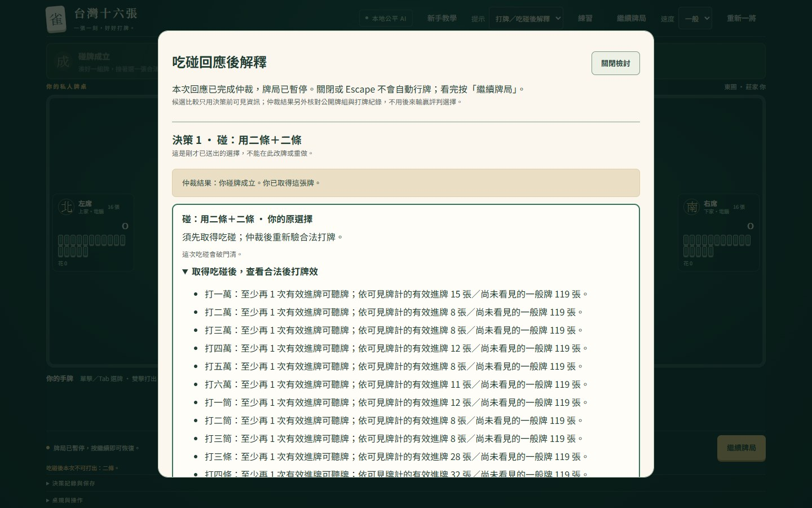
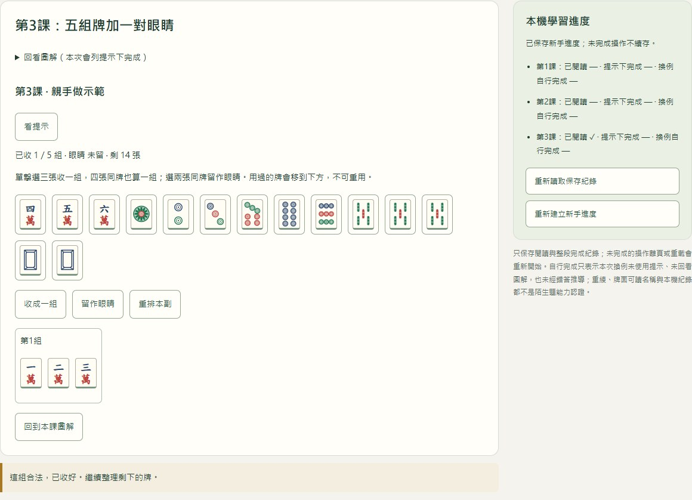
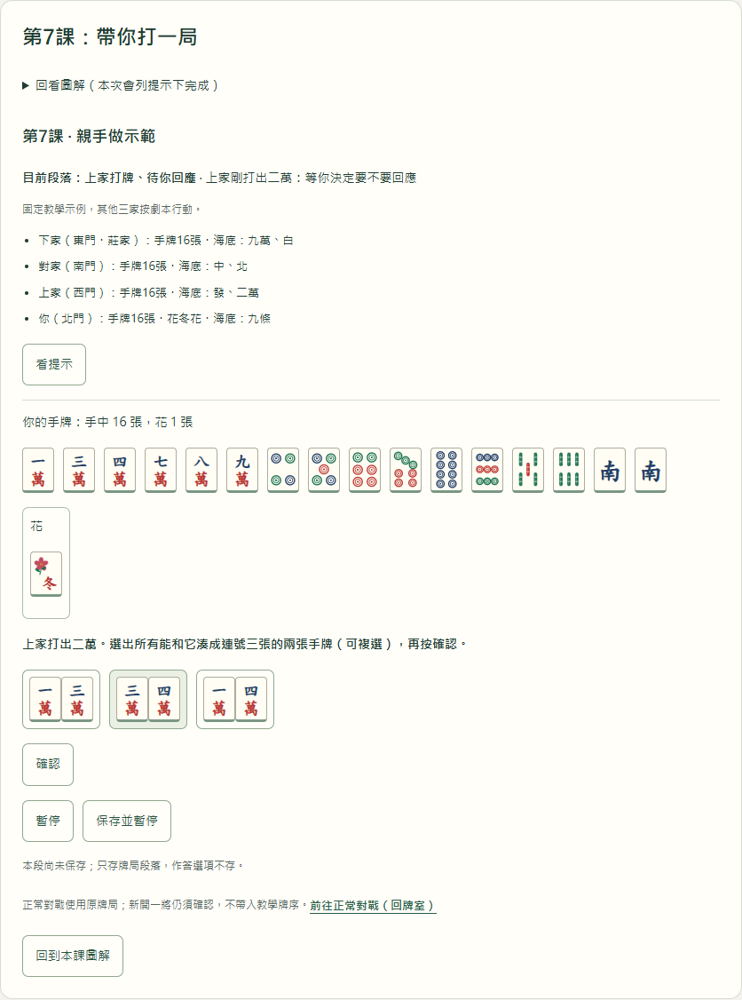

# 從零到一百的麻將路：操作展示與畫面

2026-10-24：使用者取消展示短片後續工作，不再重錄或更新字幕。下列素材及文字是2026-10-20的歷史紀錄；現行功能請依[作品介紹的體驗路徑](../../README.md#兩分鐘體驗路徑)直接操作網站。

**[觀看示範影片](../taiwan-mahjong/docs/archive/media/DEMO-20261020.mp4) · [字幕檔](../taiwan-mahjong/docs/archive/media/DEMO-20261020.vtt) · [直接遊玩](https://zhai2liu.github.io/taiwan-mahjong/) · [作品介紹](../../README.md)**

2026-10-20，依正式網站來源bdb63dffbdeefa0c7aca11b6ac75151aba586aff重新錄製，首頁及字幕使用「從零到一百的麻將路」；錄製前已核對三頁HTML與全部引用資源。實際Chrome155.0.8059.80、全新隔離瀏覽器及合成牌例／作答，無真人、聲音或音樂。片長**70秒**、1920×1080、H.264、1725763bytes（約1.65MiB），符合企畫60–90秒要求。13段中文字幕放在獨立黑底區，避開遊戲畫面與原生播放器控制列；另附VTT及下方文字導覽。若GitHub檔案頁未播放，可下載後播放。

舊版DEMO-20261017與DEMO-20261018保留錄製當時名稱及畫面，供歷史追溯；影片與下列三圖以本頁所列錄製來源為準。現行網站已開放八課並撤下玩家回饋收集，六步導覽名稱改為「操作說明」；本片保留當時畫面，不代表上述新流程已重新錄製。

## 文字版導覽

| 約略時間 | 實際操作與可觀察結果 |
|---|---|
| 0–6秒 | 新首頁三路入口及優先續玩；本片使用合成牌例 |
| 6–12秒 | 續開牌局，上家打二條，真人可選碰／吃／過；三家暗牌不揭露 |
| 12–18秒 | 選碰後完成正常仲裁，解釋寫明已取得牌，牌局保持暫停 |
| 18–23秒 | 展開合法後打牌效及門清代價；不把進牌數當收益或放槍率 |
| 23–28秒 | 實際另開吃碰類練習，原牌局仍暫停；新版牌例與作答並排 |
| 28–33秒 | 134萬遇上家2萬，選13及34兩種吃法，填合成理由 |
| 33–39秒 | 完整顯示兩組成立選項與推導，明示理由未評閱、不是正式測驗 |
| 39–43秒 | 手動保存作答並呈現已保存狀態；不自動上傳 |
| 43–48秒 | 重載先看已載入，再捲到保留的選擇與理由；曝光仍為未知 |
| 48–53秒 | 新手第3課親手組牌；任務與獨立進度並排 |
| 53–57秒 | 逐組收好順子與三張同牌，已用牌不可再用，最後留眼睛 |
| 57–61秒 | 辨認反例：東、南、西不是順子 |
| 61–70秒 | 本次示範完成，提示下完成與換例自行完成分開；真人成效與指定實機仍待 |

本片點擊真正的「同類練習」連結後，從牌桌錄影剪接到實際新分頁的錄影；結尾再次核對原牌局保存內容完全相同。沒有把同頁導航當成另開分頁，遊戲UI與規則未因錄影修改。這項行為另有[S3.2回歸](../taiwan-mahjong/docs/archive/S32-VALIDATION.md)。

## 三張畫面


實際牌桌，合成情境的上家打二條；完整行牌與桌規以[固定規則](../taiwan-mahjong-m0/RULES.md)為準。



解釋視窗區分「原決策」及「實際取得牌」。牌效是指定目標的比較，沒有將未知資訊包裝成整體最佳或放槍百分比。



新手課的實際組牌操作，第三圖擷取學習工作區，任務與獨立進度並排；123萬收好後還有14張。這是2026-10-20版本的功能示範，固定牌序是教學示例。現行八課功能與保存已於下一節補新畫面；真人題意與操作理解仍待試用。

## 八課整局畫面（2026-10-22）



正式網站來源56c106360a8b0e84f0315f7cb1c20bb7267b8826，Chrome155.0.8059.85、1440px獨立context實際操作後擷取課程工作區；為合成教學示例，非真人紀錄。第7–8課現在可走完固定一局、逐條讀台項及收付、手動保存段落後重載接續；提示與完成分列，合法選過或未贏不判成規則錯誤。正常對戰仍由原入口繼續原局，不帶入固定教學牆。

本張補充最新八課功能，不把舊影片或原三圖說成已拍到新流程；原影片與字幕保留錄製當時版本。正式操作、保存失敗／跨頁與快取返回的技術證據依[HANDOFF](../taiwan-mahjong/HANDOFF.md)，不推論真人學習成效。

錄製產生器的結尾字幕已修正為現行八課文案，沒有因此重新產生或替換舊影片；下次錄製仍須依下方流程完整播放驗收。

## 證據與使用界線

三圖及影片是功能示範，不能作為真人理解、學習進步或全平台支援的證明。最新來源與驗證見[S5.1紀錄](../taiwan-mahjong/docs/archive/S51-DEMO-VALIDATION.md)及[HANDOFF](../taiwan-mahjong/HANDOFF.md)。三圖均由bdb63df正式站重新擷取；原始錄影、逐段截圖與檢查log留在未追蹤work/。舊版影片保留供歷史記錄，既有分工本人已確認，公開授權及另擬履歷摘要仍待決定。

<details>
<summary>維護者：重新錄製方式</summary>

產生器錄製的是**正式網站**；本機建置用於來源比對，不是錄影頁面。先等該版Pages發布，再以相同提交建置。工具現在會先核對三頁HTML及引用資源；不相符會在開啟瀏覽器及建立候選之前停止。沿用Node24與既有依賴，Windows需已安裝Chrome／FFmpeg及微軟正黑體。從repository根目錄執行：

```powershell
cd outputs/taiwan-mahjong
npm ci
npm run build
cd ../..
node outputs/taiwan-mahjong-showcase/generate-demo.mjs
```

[generate-demo.mjs](generate-demo.mjs)使用既有fixtures，只在全新隔離瀏覽器作答，輸出候選到work/showcase-*；不讀日常profile，也不自動覆寫本資料夾。輸出的capture.json記錄實際章節、錯誤、時長、候選路徑及三頁資源的release指紋。

維護者先核對正式來源、60–90秒、實際播放、中文、章節及控制列未遮字幕，再將候選demo.mp4及captions.vtt複製為本資料夾對應日期的DEMO檔，同步本導覽與S51紀錄，走正常提交／CI。畫面或用詞改版時更新固定錄製步驟；不以拉長停格代替功能示範。

</details>
