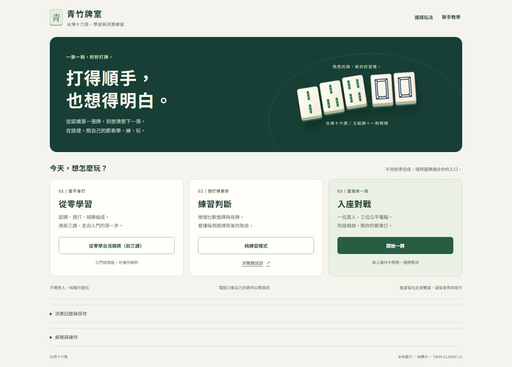
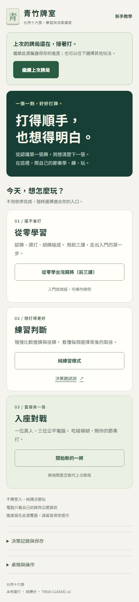

# 首頁重設計與入口整理

2026-10-18｜S1.4。依使用者「首頁畫面重新設計、UI 位置不舒服」的回饋，改善入口辨識與視覺層級。現階段本機驗證完成；指定提交、CI／正式發布結果以 [HANDOFF](HANDOFF.md) 更新為準。

## 調整結果

- 以暖白背景、深綠主視覺和原有台灣牌面建立「青竹牌室」首頁；不依賴圖片服務、遠端字型或新套件。
- 三條路線各自成卡：「從零學習」連前三課、「練習判斷」提供純練習與九題試讀、「入座對戰」直接與三位電腦遊玩。
- 有可讀牌局存檔時，續玩優先放在頁面最上方；新開局仍走既有確認，不重排或改寫玩家資料。
- 操作教學保留在頁首，桌規和保存資訊放在次層。窄畫面隱藏純裝飾牌，改為直列卡片；桌面三個主要操作能在 1440×900 首屏到達。
- 保存說明改為「留在此瀏覽器，請留意保存提示」，避免讓玩家把本機保存理解成跨裝置同步或永遠成功。

三條入口無解鎖限制。前三課仍為入門試用版，九題仍為內容試讀；本次未擴課、未啟動正式評量或人性化 AI。

## 畫面

畫面取自正式建置的隔離瀏覽器；續玩使用合成牌局。這是排版與流程證據，不是手機實機或真人易用性結果。

## 修改與回歸契約

| 位置 | 責任與限制 |
|---|---|
| `src/view.ts` 的 header／home | 只改首頁組合；對戰 header 與 UICommand 沿用原有行為 |
| `src/style.css` 的首頁區段 | 配色、按鈕與保存工具以 `.home-shell` 限定；body 背景僅在該首頁存在時套用 |
| `index.html` | 描述及標題同步學習／練習定位，三個頁面網址不變 |
| `test/e2e/home.spec.js` | 鍵盤順序／教學關閉回焦／320px 命中、亮暗強制色彩、首屏續玩與取消新局保留原文；真實別頁更新後保留入口焦點 |

保留 `[data-focus="home-entry"]`、原按鈕名稱、`./learn.html`／`./training.html` 與所有保存鍵／格式。教學和檢討 dialog 加在 body，自有深色樣式；首頁淺色樣式不能滲入。裝飾牌與箭頭不加入可及名稱。

## 本機驗證

- 型別／正式建置通過；Node **400／400**，完整 Chromium 原先 **48／48**（38.3 秒）。首頁焦點回歸先重現失敗再修復，新增兩個畫面規格後為 **50 項**；最後提交的完整結果與 CI 依 HANDOFF。
- 新回歸在桌面 1440×900、窄畫面 390×844 執行，另於 320px 檢查焦點與按鈕中心可命中、沒有橫向溢出；桌面首次開局操作位於首屏。
- 截圖另外檢查 820px、320px、390px 續玩與強制色彩；全部隔離來源，0 pageerror，沒有讀取日常 profile。
- Luna 僅作兩次限定唯讀檢查；主代理實作與實際測試。模型審查不代表外部人工審查或真人學習證據。

原始截圖、測試與擷取紀錄在忽略的根目錄 `work/home-redesign-20261018/`。手機／Safari／螢幕閱讀器仍待指定實機；不宣稱整站 WCAG 符合。發布後另核對三頁 HTML／引用資源與受影響操作，不只確認 HTTP 200。
