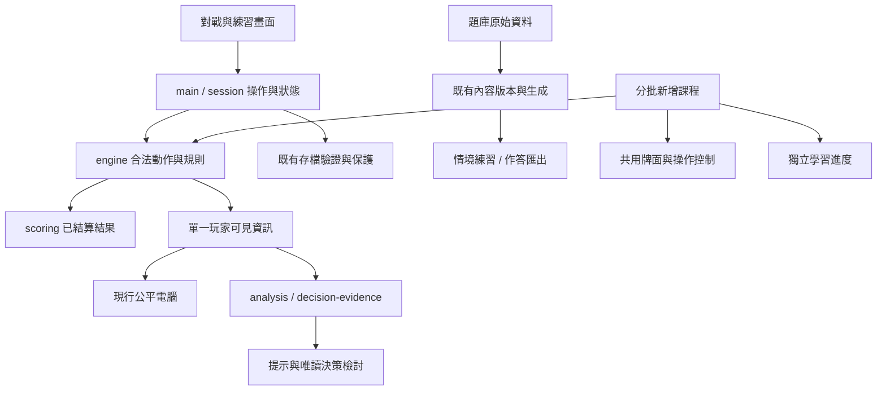

# 青竹牌室｜全面強化企畫書

**版本：1.0｜日期：2026-10-13｜對象：專案擁有者、後續開發與維護代理**

企畫目標：把現有台灣十六張遊戲，逐步完善為「能入門、能練習、能檢討、能清楚展示工程成果」的學習產品與履歷作品。

2026-10-13 使用者啟動 S0.1–S1.1，已採納本企畫定位與分批路線，方向見 [PRODUCT-DIRECTION](PRODUCT-DIRECTION.md)，工作狀態見 [ROADMAP](ROADMAP.md)。以下為企畫內容，不將尚未啟動的階段當成已完成；人性化 AI 正式整合維持另外立案。後續明確推進時從首個未完成工作包執行，不反覆詢問已採納的例行事項。

## 1. 決策摘要

**已採納定位：青竹牌室——台灣十六張麻將學習與決策練習。**

- 新手能學會認牌、合法行牌、聽胡與基本結算，逐步減少提示。
- 已會打牌的玩家能比較選擇、理解依據與限制，並檢討自己的決策。
- 想直接遊玩的玩家可以立即對戰，不需先完成課程。
- 作品集讀者能在兩分鐘內看見核心價值，在五分鐘內找到技術與驗證證據。

全面強化採分批交付，不一次重寫。先完成穩定操作、作品入口和品質基礎，再擴充內容；每個已驗收工作包可獨立發布。完整能力測驗、真人學習成效與人性化 AI 不作為所有基礎改善的前置條件。

### 固定不變的範圍

| 項目 | 約束 |
|---|---|
| 麻將規則 | 台灣十六張，固定 `TW16-CLASSIC-v1`；[RULES](../taiwan-mahjong-m0/RULES.md) 為桌規權威，不套港麻／日麻計分或胡牌資格 |
| 正式對戰 | 一位真人、三位本地公平電腦；電腦與提示只使用該座位可見資訊 |
| 交付平台 | 靜態 GitHub Pages；TypeScript、Vite、原生 HTML／CSS，優先重用既有依賴 |
| 資料 | 預設留在瀏覽器；無帳號、後端、自動回傳或跨裝置同步 |
| 開發分工 | 6.1 Sol 主導，Luna 協助限定任務；常規不使用 Astra |
| 誠實表述 | 模型複核、程式測試、真人可用性、學習成效分開記錄 |

### 這次企畫提出的方向變更

原 2026-10-09 方向以進階訓練為主、新手「維護不擴充」；S0.1 已調整為兩條學習路線並同步方向、ROADMAP、README 及啟動指引。保留進階能力、分批新增完整入門；功能完成仍依驗收，不因定位採納就通關。

作品集展示為並行交付，不改成只做展示的空殼。玩法擴充以使用需求為依據，不因履歷需要而硬加服務端、熱門框架或模型 API。

## 2. 現況基線與既有資產

企畫編製時基準為 `5363de8`，最近功能發布 `fb438a7`；當時已核對 Actions 38348866774 與正式入口，發布記錄為 340 測試。以下保留規劃基線；**當前完成度與新驗證依 HANDOFF／ROADMAP**。前包作品集報告與本企畫已在 S0.1–S1.1 一併入版，不再是待保存的未知變更。

| 能力 | 現況 | 本企畫怎麼處理 |
|---|---|---|
| 完整對戰、補花、吃碰槓胡、計台、續局 | 已發布 | 維護與回歸，不重寫引擎 |
| 台灣牌面、中央海底、雙擊出牌、結算彈窗與逐條台項 | 已發布 | 優化辨識及節奏，保留現有行為 |
| 純牌效練習、即時輔助、出牌後解釋、局後檢討 | 已發布；事後解釋目前只涵蓋打牌 | 補流程連接與必要的吃碰解釋 |
| 新手教學 | 六步操作導覽已發布 | 保留為快速導覽，另增循序課程 |
| 用詞在地化、題目完整內容版本、作答下載 | 已發布 | 維護現有規範，不另做第二套版本系統 |
| 情境題 | 13 題模型複核；9 題試讀、4 題保留候選 | 先核對理解與題族，不直接批量生題 |
| 正式能力測驗／學習成效 | 尚未完成 | 與內容試讀明確區隔，依真人證據推進 |
| 人性化 AI、牌風與阻莊研究 | 有離線研究，未接正式策略 | 保留為 S6 條件式擴充 |
| 測試、存檔防護、發布與交接 | 已有相當基礎 | 補 PR 檢查、少量真瀏覽器回歸與可讀的品質摘要 |
| 履歷展示 | 缺根目錄 README、個人角色、短版 Demo 與案例整理 | S0 就開始，不等產品全部完成 |

目前沒有獨立真人題意試讀／學習成效證據。專案擁有者歷次試玩及問題回報是真實產品回饋，但不能等同目標玩家研究或陌生題能力提升。

## 3. 玩家路線與資訊安排

首頁採三個主要入口，加上獨立的作品介紹連結：

| 入口 | 使用者看到的目的 | 建議流程 |
|---|---|---|
| 從零學台灣麻將 | 學會看牌、打牌、胡牌與看結算 | 短課 → 親手操作 → 換例練習 → 引導牌局 → 自己試一局 |
| 練習判斷 | 比較打牌、吃碰與局況取捨 | 純練習／情境題 → 先作決定 → 看原因 → 練另一種局面 |
| 開始對戰 | 直接與三位電腦遊玩 | 續局或新局 → 選擇提示程度 → 結算 → 少量決策檢討 |

進階玩家不受新手課解鎖限制。首頁第一次只說明差異與建議入口，不先要求填問卷、選人格或登入。既有網址與 `training.html` 保持可達，不為改入口搬動整個專案。

畫面資訊分三層：第一層是「現在輪到誰、你能做什麼」；第二層是本次選擇的結果與原因；第三層才是完整候選、數學依據、拆法及桌規。關鍵操作與結算不能因展開說明而被擠出主要視野。

## 4. 互動、美術與正向回饋

### 必須先可靠的操作

- 同張牌單擊選取／預覽、雙擊打出；保留 Enter／空白鍵操作。觸控若仍易誤觸，先以實測確認問題，再提供等效可及操作，不全面恢復多餘按鈕。
- 吃牌同時列合法的兩種組合；134 遇上家 2，13 與 34 都能辨認。選吃碰後的可打牌與限制有直接說明。
- 暫停、提示、教學、練習返回、結算與下一局的狀態一致；畫面重繪不能跳焦點或讓舊操作再次生效。
- 結算上方立即看見誰胡、胡法、牌型／每項台數與得分；桌規或拆法按需展開，查看／重載不得重新付款。
- 試讀有內容時防誤離頁；說清楚是否已保存、已匯出，以及匯出後若繼續修改還有哪些未保存內容。

### 視覺與用詞

沿用現有深綠牌桌與本地向量牌面，優先手牌尺寸、選中狀態、最新打牌、回應來源及中文字辨識。用少量 CSS 變數整理字級、間距、色彩與控制項尺寸，不另建設計系統套件。

依 [LOCAL-TERMS](LOCAL-TERMS.md) 使用條、眼睛、海底、單吊、雙頭、打牌等主要用詞；必要的桌上術語首次配牌例。距離聽牌的有效改善次數不是摸牌回合數，完整牌組數不是同一指標，不為俗稱而改算法。

### 正向回饋

回饋具體描述剛才做對的事，例如「這次選擇保留較多可改善的牌」「已找出兩種合法吃法」。原有胡牌與進步回饋繼續保留。一次看一個重點，結算或課末給一個下一步；不要每次打牌都跳阻擋視窗。

練習中的閱讀、使用提示完成、獨立完成分開呈現；允許錯誤後再試、跳過與重練。不設每日連續登入壓力、貨幣、排行榜或假牌技分數。小型音效僅在操作驗證支持其必要性後加入，需可關閉且不作唯一提示。

## 5. 完整新手課：先教會，再增加例外

每課採「一個目標 → 短圖解 → 親手做 → 解釋 → 換例再試」。原有六步保留為快速操作導覽；完整課程放獨立學習入口，避免巨型彈窗。

| 課 | 內容 | 必須有的驗收任務 |
|---|---|---|
| 1 認牌與桌面 | 萬、筒、條、字、花；上／下／對家；海底與桌上牌組 | 找指定牌及打牌來源；辨認字牌不能組連號 |
| 2 摸與打 | 一般起手的 16→17→16、莊家先打、補花、輪流行動 | 完成一輪操作並指出下一個行動者；不把槓後實體張數套成固定 17 |
| 3 胡牌的組成 | 五組完整牌加一對眼睛；順子、三張同牌、槓 | 組一副合法牌型、找一個不合法例子，不重複使用同一張牌 |
| 4 吃碰槓與過 | 吃只取上家、回應優先、吃碰後打牌、槓與補牌 | 134 遇 2 兩吃法、不能吃對家、吃碰後合法打牌；槓用獨立短例 |
| 5 聽牌與胡牌 | 等待牌、自摸、胡別人、放槍與本桌過水 | 換例找等待牌；分辨牌型完成與當下合法可胡 |
| 6 結算與莊家 | 底／台、門清／三元／正花、付款、連莊與流局 | 讀已結算明細、指出付款對象與莊家是否續留 |
| 7 帶你打一局 | 串接前六課，分段提示 | 固定教學牌局操作到結算，知道每次停下來在等誰 |
| 8 自己試一局 | 選提示程度、查說明、暫停與續玩 | 在另一局面完成合法操作與讀結算；不以是否胡牌判通關 |

第 1–3 課完成即先試用，修訂後再做後五課。涉及行牌的情境沿用凍結引擎；教學固定牌序標為「教學示例」，不得當作正常公平對戰。第一版不做自由拖拉、聊天老師或通用課程平台。

實體桌補充列為課程附錄：抓位、起莊、洗牌砌牌、擲骰取牌、相公與詐胡的概念，以及開打前確認桌規。明確標出網頁代勞部分與實桌差異，不新增凍結桌規之外的罰則。

## 6. 進階訓練：完善證據與練習循環

保留四類能力：牌效選擇、依公開資訊判斷安全範圍、吃碰代價、莊家／連莊取捨。每題只承擔清楚的目標；兩個目標衝突時呈現取捨，不把任意權重包裝成唯一答案。

| 改善 | 實作方向 | 驗收界線 |
|---|---|---|
| 先決策、再解釋 | 重用已發布打牌解釋；按需補吃／碰／過的事後比較 | 記錄原本選擇與最後仲裁結果；提交成功不代表一定取得吃碰，不重演動作 |
| 局後下一步 | 最多三筆檢討後，連到相同能力的另一題／練習 | 優先簡單能力對照表，不推論完整弱點人格或建自動推薦模型 |
| 題目品質 | 維護目標、題族、答案集合、推導、反例、桌規與版本 | 手工可核對或獨立枚舉；不以現行 AI 選牌當標準答案 |
| 安全與阻莊 | 教對手別充分安全證明、未排除風險及攻守代價 | 不把「未知」當危險率；不把避免放槍等同阻止莊家自摸／流局續莊 |
| 作答回饋 | 選項集合結果與理由分開，顯示條件與限制 | 理由未評閱就明示；第一版不以 LLM 自動判自由文字 |
| 內容供給 | 先修現有 9 題及複核 4 候選，再按未覆蓋的能力補題 | 每批約 4–6 題可作編輯上限，非強制數量；覆蓋不足才增，不先衝 60 題 |

### 正式能力測驗的獨立門檻

訓練、題意試讀、正式測驗分開。模型複核不是難度校準；同題換花色或換牌序不是陌生題。既有 4 題目前僅為保留候選，不直接宣布測驗可用。

正式評量前，需完成題族隔離、難度配對、提示／答案曝光紀錄、未答與中途離開規則、答案與人工理由規準。若題目或分析版本變更，保留原作答版本，不能靜默重評。尚未通過則繼續提供「練習／試讀」，不阻擋其他功能發布。

**靜態網站無法把答案對瀏覽器或公開原始碼保密。** 首次曝光紀錄只是本機自陳與操作紀錄，換裝置、清資料或看原始碼後無法證明未見題；不得宣稱防作弊認證測驗。真人研究可採受控流程與曝光詢問，限制寫入結果。若未來要高利害能力認證，必須另立服務端與研究方案，不在本案首版範圍。

## 7. 架構與資料：沿用核心，逐個擴充

教學可建立獨立的引擎情境，但不能把完整狀態傳給正式 AI 或教練。檢討只讀當時快照，不用事後揭露暗牌來評判當時決策。結算 UI 格式化已完成結果，不重新計台或付款。

### 修改位置與最少新增

| 工作 | 優先重用 | 允許的最小擴充 |
|---|---|---|
| 操作、提示、結算 | `main.ts`、`view.ts`、`hand-review-view.ts` | 針對實際流程修正，不建立新全域狀態框架 |
| 新手課 | `tutorial-view.ts`、`tile-face.ts`、`engine.ts` | 有需求才新增課程頁、少量課程資料與進度處理；沿用原生控制項 |
| 題庫與匯出 | `training.ts`、`prepare-training.mjs`、兩份題庫 JSON、`review-trial.mjs` | 移除現有固定九題／固定審核狀態限制時同步調整驗證；不能只改畫面顯示數字 |
| 牌效、安全、檢討 | `analysis.ts`、`decision-evidence.ts`、`decision-snapshot.ts`、`hand-review.ts` | 小型能力與題目對照；不再做第二套牌理算法 |
| 保存 | 現有對戰、練習、`review:v2` 邊界 | 新手進度與必要草稿獨立版本，先定格式再寫入 |

### 資料契約

1. 對戰與練習現有 v1、檢討 v2 保持相容；不得藉升級清空使用者資料。
2. 題目沿用 `contentRevision` 與 schema 2 匯出；本機審閱仍支援 schema 1。新增欄位或更動語義時明定版本／相容策略，不能無條件把舊紀錄套新答案。
3. 新手進度至少區分課程版本、已閱讀、提示下完成、獨立完成。這是本機練習紀錄，不是可驗證證書。
4. S1 先做試讀離頁防護；持久草稿若納入 S3，必須有容量上限、保存通知、版本不符處理、重載恢復、跨頁衝突與清除確認。瀏覽器原生離頁提示只是輔助，不能保證攔住手機關閉或崩潰。
   匯出只能確認已交由瀏覽器處理，不能單憑下載連結被點擊就宣稱檔案已落盤；保留可複製內容與原草稿，提醒狀態不得掩蓋下載失敗。
5. 保存失敗留住記憶體與舊檔，提供重試／匯出；壞檔保留且拒絕使用。資料匯入是獨立功能，不因已有匯出就直接加入無驗證 JSON 讀取。
6. 只保存學習與除錯必要資料，不採集身份、全程操作錄影或未授權分析。回饋仍由玩家自行交回；GitHub Pages 無法直接安全代收私有回覆，不把 token 寫進前端。

## 8. 品質、效能與發布

### 測試層次

- 規則與算法：保留人工牌例、獨立推導、容量／邊界測試。修改核心流程才加相應模擬，不為文件或配色跑長牌局。
- 操作與存檔：使用現有控制器與失敗注入案例，保護舊檔、重入、跨頁、結算一次性及提示失敗隔離。
- 真瀏覽器：先固定三條可重現路徑——打牌與事後解釋、結算／續局／重載、試讀作答／匯出／離頁，再逐條加入自動執行。新手課第一個切片再補一條。沿用現有 fixture，使用獨立來源；測試頁不進正式產物。每條標明人工或自動驗收，PR 檢查可先獨立完成。
- 必要時只新增一個適合的瀏覽器測試開發依賴，先確認現有工具是否已能覆蓋；不得為單純文字變動導入大型測試平台。
- 人工觀察：觸控、螢幕閱讀器、視覺對比、實機與真人理解由相應測試補足；代理自測不可冒稱真人試用。

### CI 與發布規則

PR 跑型別、測試、建置；只有可信 main 推送／受控手動流程可以發布。不要讓 fork PR 拿到部署權限，也不使用高權限流程執行未信任程式。路徑條件須涵蓋題庫、生成器、共用規則案例與 workflow；確保必要檢查不因跳過而永遠等待。機制依 [GitHub workflow events](https://docs.github.com/en/actions/reference/workflows-and-actions/events-that-trigger-workflows) 設定。

正式交付核對指定提交、CI 成功、Pages 引用資源與受影響操作。部署失敗時保留上一可用版本，記錄失敗原因與可重試步驟；不以本機成功宣稱已上線，也不反覆重跑未改變的失敗部署。

### 可及性與支援

以 [WCAG 2.2 快速參考](https://www.w3.org/WAI/WCAG22/quickref/) 作檢查依據：鍵盤可操作、焦點可見且未被遮住、視窗可退出、牌有可讀名稱、狀態不只靠顏色、文字對比與縮放、觸控目標可點。自動掃描通過不代表全面符合 WCAG。

先列 Windows 桌面 Chrome／Edge 的實測版本；390 寬畫面驗核心操作，320 寬至少不隱藏必要控制；再補 Android Chrome 與 iPhone Safari 實機。沒有裝置就標「未驗」，不得先承諾全裝置支援。鍵盤、200% 文字縮放、減少動態效果列基本驗收。

### 效能與依賴

現有 M5.1 有歷史數據，先建立目前版本、指定裝置與固定場景的載入／選牌／候選分析基準。記錄量測次數、中位數與尾端值，不用一筆快速樣本下結論。S1 取得基準後設定可接受預算；只有確認瓶頸才做 worker、演算法或快取改善。依賴更新先檢查風險、相容性與回歸，不為履歷盲追最新版本。

### 缺陷處理

資料損失、暗牌外洩、非法動作、錯誤計台／重複付款列最高優先；核心流程卡死或誤操作其次；文案與外觀缺口按影響排序。正式版本須在已列測試範圍內沒有未解的前兩類缺陷，其餘問題記錄重現方法、影響、暫時處置與下一步。

## 9. 真人驗證與成效指標

| 面向 | 要記什麼 | 可以說什麼／不能說什麼 |
|---|---|---|
| 操作可用性 | 指定任務的完成數／總人數、需要協助的步驟、錯誤與放棄原因 | 可說本次受測者卡在哪；不能據少數人推出全民完成率 |
| 新手理解 | 換例後能否認牌、合法摸打、找等待牌與讀結算；提示使用狀態 | 可區分獨立與提示下完成；不能把下一頁點擊當學會 |
| 進階理解 | 相同能力不同題族的答案、理由規準、曝光與版本 | 可報有限的改善訊號；未匹配難度不能稱訓練有效 |
| 工程品質 | 受影響回歸、存檔故障案例、支援裝置、當版效能與部署結果 | 可說已驗證範圍；測試數不能轉為學習成效或零缺陷保證 |
| 作品展示 | 未參與專案者是否能找到 Demo、描述價值、指出本人角色 | 可改善展示；不保證因此獲得面試或錄取 |

S2 前三課完成後，先邀約約 3–5 位新手做形成性試用；S3 原有題意也可先找少量已會打的玩家試讀。人數是找問題的起點，不是統計充分門檻。兩族群分開記錄，訓練和前後測不可重用相同題族；資料不足就維持「待驗證」。

每次只安排清楚任務，先讓對方自己操作，必要時才協助並記錄。彙整「觀察→原因假設→修正→再試」；原始答案與回饋留在不入 Git 的 `work/`，公開去識別摘要與截圖前取得同意，不虛構引用或人數。

真人招募或實機暫缺時，可以完成內容修訂、工程驗證、展示材料；在阻擋的特定驗收項目上停下，不能把整個專案停住，也不能填入虛假通過結果。

## 10. 履歷作品集交付

最低展示包包含：根目錄 README、一張架構與資訊邊界圖、三個技術案例、60–90 秒實際操作影片、三張當前畫面、可重現開發／測試指引，以及明確版本與限制。README／About 需一致且能直接進 Demo，符合 [GitHub 作品展示建議](https://docs.github.com/en/account-and-profile/tutorials/using-your-github-profile-to-enhance-your-resume)。

案例選用現有實作：不偷看暗牌的提示、存檔／結算完整性、從真實回饋改善操作。每例寫問題、選擇、取捨、驗證與仍有限制，附實作或測試連結。

個人角色與 AI 協助分開：可根據既有紀錄描述需求決策、在地桌規、試玩回報和驗收；本人能解釋或獨立修改哪些模組，由本人確認。保留 Codex 提交歷史，不改作者、湊提交數或製造假團隊審查。未確認的履歷能力不直接公開。

作品介紹先用「AI 協作開發的台灣麻將學習產品」。遊戲內 AI 是本地策略，不宣稱使用 LLM；沒有後端或機器學習訓練，就不寫成相關實務經驗。未確定職缺時先完成共同材料，後續只調整案例排序與摘要。

素材來源、原創 SVG、使用本機字型、第三方參考分開記錄。擁有者再選擇程式與素材授權，不預先套用 MIT；尚未選授權不妨礙其他工作。展示版可在正式能力測驗之前發布，只要清楚標示現況。

## 11. 分階段執行表

S 為本次強化工作編號，與歷史 M／L 並存；不改寫歷史完成紀錄。S0 採納後以此表排程，L 線仍作進階內容驗收對照。

| 階段 | 目的／主要工作 | 依賴 | 投入 | 通關條件 |
|---|---|---|---|---|
| S0 定位與可見成果 | 同步方向、根目錄 README、案例架構、文件入口 | 本企畫採納 | 小～中 | 已發布／原型／研究清楚；外部讀者能找到展示與驗證；保留現有資產 |
| S1 操作與品質基礎 | 試讀防離頁、對戰／結算節奏、PR 檢查、三條瀏覽器回歸、視覺／效能基準 | S0 | 中 | 核心路徑無已知阻斷／資料損失，舊存檔相容，限定裝置驗收可重跑 |
| S2 新手學習 | 前三課切片、獨立進度、真人試讀；再做4–8課與實桌附錄 | S1；真人可並行籌備 | 大，拆包 | 課內操作與規則可驗；新手換例能實作；真人結果與未驗範圍明示 |
| S3 進階訓練完善 | 九題修訂、能力導引、必要事後吃碰解釋、草稿／曝光、測驗候選 | S1；接既有 L3 | 中～大 | 版本／提示／題族可追溯；練習可用；正式評量另依L3／L4門檻 |
| S4 使用者與支援驗證 | 兩族群試用、題族難度／理由校準、指定實機與可及性修正 | 可從S2／S3首個切片開始 | 中＋外部等待 | 有真實觀察及修正證據；未取得資料明列，學習成效不超過證據 |
| S5 作品版收斂 | 展示短片、案例、Release、支援／限制、來源授權、履歷摘要 | S0/S1；納入已通關S2/S3成果 | 中 | 可重現與展示，來源提交可追溯，技術／本人／成效敘述一致 |
| S6 人性化 AI 選配 | 研究需求再確認、離線策略對照、必要時人格實裝 | 使用者另行啟動＋必要證據 | 待立案 | 不納入本次核心版完成條件 |

投入「小」表示單一責任且少量整合；「中」需跨模組與瀏覽器驗證；「大」必須再拆。不是固定天數、工時或帳戶額度承諾；完成首批包後再以實際成本修正估計。

預設順序：**S0 → S1 → S2 前三課 → S2 修訂／後五課與 S3 按缺口逐包推進 → S4 收斂 → S5 展示版。** S0 的方向、README／架構／案例已完成；S4 的首批試讀可在內容切片完成後提早進行。S3 只依賴 S1，不必等八課完成；等待新手回饋時優先處理可獨立的 S3 或既有 L3 缺口。若收到進階題回饋，亦可在前三課之前先修阻斷問題。主代理同時只整合一個行為包，避免多路線搶改共用檔。

分批發布：S0／S1 完成可先交付「可靠展示基礎版」；前三課驗收後發布「入門試用版」；八課與對應驗收完成後才稱「完整入門路線」。S5 可封存當時已驗證的成果，不必等待正式能力測驗或 S6，版本說明必須列出仍屬試讀與未驗證部分。

### 可直接領取的工作包

| ID | 具體交付 | 主要驗收 |
|---|---|---|
| S0.1 | 同步已採納定位、範圍與文件權威；整理最新／歷史入口 | 方向無衝突；不把提案寫已完成 |
| S0.2 | 根目錄 README、架構圖、三案例提綱與 Demo 路徑 | 連結／命令有效；個人描述有依據；不改 Git 歷史 |
| S1.1 | 試讀離頁防護及匯出後再修改提醒 | 返回／重載、取消／繼續、只有回饋、下載失敗都測；不動對戰存檔 |
| S1.2a | PR 型別／測試／建置檢查 | PR 無部署權限；必要檢查不因路徑跳過卡住；main部署仍正常 |
| S1.2b | 三條瀏覽器核心回歸，先重現再逐條自動化 | 沿用fixture，先評估既有工具；正式產物排除測試頁；分清人工／自動結果 |
| S1.3 | 主要流程視覺與焦點修整、具名支援／效能基準 | 桌面／窄畫面、鍵盤、暫停返回與結算；記基準，不先大重構 |
| S2.1 | 第1–3課的最小可操作版本與必要進度 | 教學隔離、換例任務、保存失敗／壞檔／重載 |
| S2.2 | 前三課形成性試用與修訂 | 真實卡點與修正；缺真人則明示，不跳過內容檢查 |
| S2.3 | 第4–6課 | 吃碰槓／過水／結算正反例均與凍結引擎一致 |
| S2.4 | 第7–8課、實桌附錄與正常對戰連接 | 示例與正式對戰隔離，不以胡牌與否評完成 |
| S3.1 | 九題修訂、四能力導引、既有題量限制同步 | 題幹／答案版本、生成器、匯出與本機審閱一致 |
| S3.2 | 局後下一步與必要吃碰事後解釋 | 公開快照、仲裁狀態、並列候選、不重新提交動作 |
| S3.3 | 必要草稿續存、曝光與版本紀錄 | 舊匯出可讀、未知曝光不當首次、存檔衝突不覆寫 |
| S3.4 | 正式評量候選審核與難度／理由規準 | 題族隔離與真人理解不足時維持候選；可獨立暫緩 |
| S4.1 | 新手與熟手分開試用、問題修訂／複測摘要 | 寫明人數、任務、版本、提示與協助，不混成普遍成效 |
| S4.2 | 指定實機、可及性與回歸收斂 | 未支援裝置明示，核心缺陷無未解；不假稱完整認證 |
| S5.1 | 影片／三圖／三案例／版本與支援說明 | 內容對應當前版本；本人確認貢獻敘述 |
| S5.2 | Release、來源／授權決策、回復演練與履歷摘要 | CI／正式資源／核心流程核對，回復不破壞新舊資料 |

### 下一次啟動的首批範圍

先完成 **S0.1、S0.2、S1.1**；其中 S1.1 必須作為獨立行為修改包驗收。完成後立即更新交接，下一包接 S1.2a，再處理 S1.2b。首批不寫完整新手系統、不改人格 AI、不擴大量題庫；先交付可看得見且風險有限的成果。

## 12. 人性化 AI 的後續位置

使用者先前指定不實裝，這次全面企畫不自動解除。S6 若另行啟動，再根據 [人性化 AI 設計](HUMAN-AI-DESIGN.md) 與既有離線研究，定義玩家實際需要的對手差異。

進攻、保守、保留安全張與阻莊等參數只能改變合法選擇的偏好，不改遊戲規則、偷看暗牌或暗改摸牌。保留安全張要衡量當前牌效、未來安全資源、可見牌與連莊代價；「混淆視聽」只能作行為假說，不能宣稱必然效果。

先做可重現的離線比較與可讀案例，再驗風格是否可辨識、對局是否正常、提示與AI是否各守資訊邊界。未校準風險分數不稱放槍率；人性化不是單純增加隨機錯誤。沒有必要性證據或成本超出範圍，就保留現行基線。

## 13. 文件與維護制度

| 文件 | 唯一責任 |
|---|---|
| 根目錄 README（S0新增） | 給第一次看到專案的人：價值、Demo、角色、案例、開發入口 |
| 遊戲 README | 使用、啟動與維護導航，不繼續塞整段里程碑流水帳 |
| PRODUCT-DIRECTION | 已採納定位、範圍與延後條件 |
| 本企畫 | 強化目標、工作包與驗收框架；規劃變更要記理由 |
| ROADMAP | 工作包狀態、依賴與下一包；連到具體證據 |
| HANDOFF | 最新完成、版本、驗證、未決風險、下一個具體動作與用量 |
| RULES／LOCAL-TERMS | 分別管理固定桌規及玩家用詞，不互相取代 |
| MAINTENANCE | 現行資料流、修改位置、相容／恢復與必要測試 |
| 各驗收文件與歷史索引 | 保存當時證據，日期／版本清楚；不冒充當前狀態 |

每包最多更新真正受影響的權威文件，不複製同一規格到多處。先改善索引與過時敘述，再評估是否需要歸檔；不為美化目錄搬動整個工程、打斷引用或刪除證據。新增規格只在既有文件無法承擔時建立。

## 14. 分工、資源與交接

| 負責者 | 任務 | 不可替代的界線 |
|---|---|---|
| 使用者 | 產品取捨、實際試玩、提供／招募回饋、確認個人履歷敘述與授權選擇 | 不要求逐個核准例行可逆修正；必需的人類決策集中處理 |
| 6.1 Sol 主代理 | 規格、核心邏輯、資訊與資料邊界、整合、驗收／發布、文件一致性 | 對最終成果負責，不能只貼子代理結論 |
| Luna 限定子代理 | 用詞／課文盤點、單一測試審查、文件連結檢查、範圍明確的獨立任務 | 不代替真人受測者；未授權不改核心桌規／跨模組存檔 |

預設最多一位 Luna 並行；先界定檔案、交付與不可修改區，避免多人改同檔。主代理抽查證據，不把多模型意見當獨立領域專家驗證。開發模型與遊戲中的三位 AI 是不同概念。

五小時帳戶比例只用來安排收斂，不能換算精確 token。長工作開工與關鍵檢查點查用量；帳戶剩餘接近 20% 時不新增大包，接近 15% 時優先完成目前包的必要驗證、保存與交接。這是工作策略，不能保證其他執行緒不消耗額度；不自行重設或設自動續跑。

每包交接最少列：ID／完成範圍、改檔與提交、測試版本與結果、發布狀態、已知限制、下一動作、暫存服務／分頁、待使用者項目。額度不足時先寫未完成位置與重現步驟，不把半成品標成完成。

## 15. 共用完成定義與風險處理

一個工作包完成，必須有：可觀察的成果、適用測試／操作證據、資料相容與失敗處理、更新文件、清楚未驗範圍；正式發布包另有提交、CI 與正式站核對。純文件包只查內容、連結與一致性，不重跑遊戲全套。

| 風險 | 觸發訊號 | 處置／停止條件 |
|---|---|---|
| 範圍膨脹 | 一包同時改課程、題庫、AI與存檔 | 拆成最小可驗包，依S順序；S6保持另案 |
| 規則漂移 | 為教學簡化而更改胡牌／過水／付款 | 回凍結RULES與獨立牌例；未釐清不發布 |
| 資料損失 | 新格式覆蓋舊檔、保存失敗仍切頁 | 保留資料、隔離版本、補故障回歸；未解不得通關 |
| 學習成效誤報 | 用答對熟題、AI一致率或測試數當能力 | 維持試讀標示，補題族／曝光／真人證據 |
| 實機／真人受阻 | 缺指定裝置或受測者 | 只暫停依賴項，其他獨立包繼續；不冒稱驗過 |
| 部署服務故障 | 同一提交CI／Pages外部失敗 | 保存可發布產物與錯誤，等服務恢復再一次核對；不改安全設定繞過 |
| 作品貢獻不實 | 文件把AI產出直接寫成本人熟練能力 | 改為有依據的角色與案例，由本人確認後對外使用 |
| 文件負擔增長 | 相同進度在多份文件互相矛盾 | 保留單一權威與連結，歷史加日期，不再堆重複報告 |

**核心版可交付的界線：** 正常對戰可靠、兩條學習路線的已承諾範圍可用、真實驗證／未驗範圍明示、資料可保護、作品材料能重現並誠實說明。正式學習成效未確立時仍可發布產品與作品集；不可把尚未完成的測驗或人格 AI 寫進已交付清單。

## 16. 參考與本輪交付界線

本企畫整合 [現行方向](PRODUCT-DIRECTION.md)、[既有路線](ROADMAP.md)、[新手提案](BEGINNER-LEARNING-PROPOSAL.md)、[作品集檢視](PORTFOLIO-READINESS-REVIEW.md)、[用語規範](LOCAL-TERMS.md) 及既有程式／驗收證據。外部參考僅用於可及性、CI與展示準備，不用來改台灣桌規。

企畫編製包僅文件交付；後續 S0.1–S1.1 已啟動，完成與發布依 HANDOFF／ROADMAP 及對應驗收。本文保留規劃基準，不以企畫描述代替功能證據。
