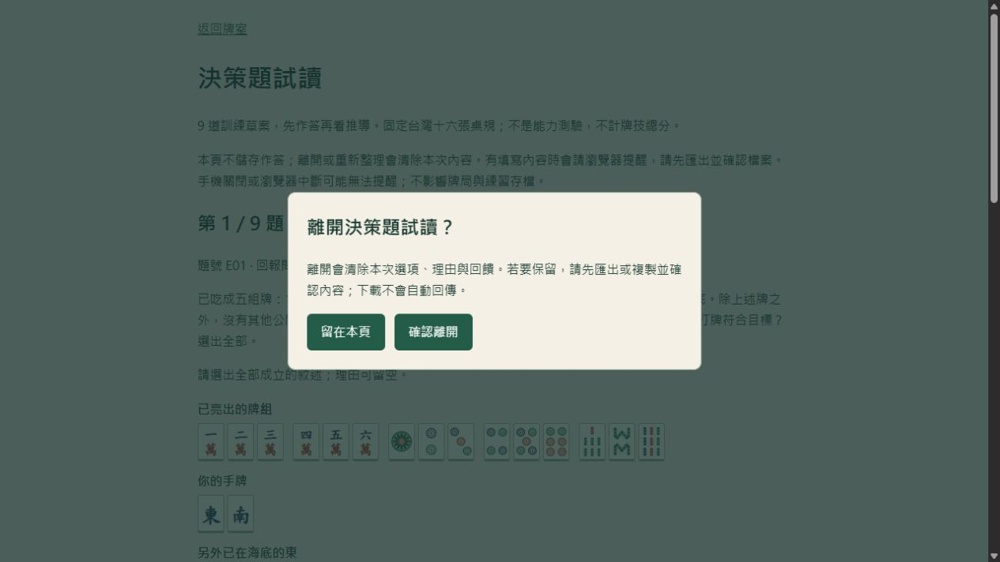

# S0.1–S1.1：方向、作品入口與試讀防護

2026-10-13。使用者啟動本次三包；本機驗收完成，正式發布來源與核對見 [HANDOFF](HANDOFF.md)。

## S0.1：已採納方向

採納「台灣十六張麻將學習與決策練習」，新手／進階兩路線與直接對戰共存。同步 PRODUCT-DIRECTION、ROADMAP、遊戲 README、MASTER-IMPROVEMENT-PLAN、AGENTS 啟動入口及舊提案狀態。

八課完整入門屬 S2 後續；正式評量仍需題族、難度、曝光與真人證據。現行桌規／策略／存檔不變，人性化 AI 維持另行立案。歷史文件留存當時背景，不將先前「維護不擴充」當現行決議。

## S0.2：作品入口

新增 [根目錄 README](../../README.md)，含正式 Demo、已上線／原型／後續／離線研究狀態、兩分鐘體驗路徑、資訊邊界架構圖及三個工程案例。個人角色以使用者實際需求決策及試玩回饋為依據，AI 實作與驗證另外說明；保留真實作者歷史，不推定本人手寫比例或技術熟練度。

案例連到資訊相同但可胡不同的反例、保存故障／跨頁／一次付款、134 遇 2 的兩種吃法及操作改善。短片、最新完整展示素材、Release 與授權選擇仍在 S5。根 .gitignore 加 README 白名單；遊戲 README 保留開發資訊並收合工程歷史索引。

## S1.1：功能與資料界線

- 選項、理由、回饋或已揭示內容存在時才註冊 beforeunload；清空未提交內容可解除。切題保留草稿且不增加重複監聽。
- 「返回牌室」使用原生 HTML dialog，預設焦點在「留在本頁」。取消／Escape 保留內容並回焦點；只有按「確認離開」才解除監聽並返回。另開分頁的 Ctrl／Meta 等修飾操作不阻擋原頁。
- 重新整理、關閉分頁或其他網址跳轉使用瀏覽器原生提醒。內建瀏覽器驗收可觀察重新整理被攔住且內容保留；其原生確認並未提供可操作視窗，因此返回改用頁內確認。未宣稱跨瀏覽器原生確認按鈕均已驗。
- 作答與回饋各自保留最近交由瀏覽器下載的內容快照；後續修改顯示需要再次匯出的類型，回復相同內容解除「新修改」提示。只下載回饋不能當作作答已匯出。
- 下載只能確認已交給瀏覽器，不能推定檔案已存好；成功發起下載也保留離頁提醒。失敗保留原草稿及可複製文字，不覆蓋最近成功發起的匯出快照。
- 同樣文字的狀態不重複更新，避免每次鍵入都重新朗讀提醒。預覽標為「最近一次匯出內容」，避免誤認為修改後的最新紀錄。

仍是頁內記憶體草稿，沒有持久保存、自動上傳或新存檔鍵。匯出 schema 2、題庫 contentRevision、題目／答案及桌規不變，舊 schema 1 的本機審閱仍可用。試讀頁不操作對戰／練習／檢討儲存。

## 自動與實際操作證據

最終本機 npm test：**342 passed，0 failed**；check 與 production build 成功。記錄 `work/s01-tests.log`。試讀測試共五項，新增防離頁與明確返回分支，擴充匯出後修改、分別匯出、失敗保留快照與回復內容；既有完整規則、存檔、付款、AI 與題庫回歸通過。

內建瀏覽器獨立來源 `http://127.0.0.1:4204/`：

| 操作 | 實際結果 |
|---|---|
| 空白試讀返回 | 直接回首頁 |
| 只有回饋時返回 | 顯示確認，預設「留在本頁」；取消及 Escape 保留回饋與返回入口焦點 |
| 回饋 TXT 下載 | 真實檔案讀回含 E01 合成回饋，不含作答理由 |
| 匯出後再填／重新整理 | 顯示回饋需重匯提醒，重新整理被攔住且修改後內容保留 |
| 確認離開 | 成功回首頁；再次進試讀為空白 |
| E01 選東、填理由、提交 | 符合選項集合，焦點回到答案；理由仍標未評閱 |
| 作答 JSON 下載 | 真實 schema 2、九題、E01 已提交；其餘未答，題庫版本保持一致 |
| 下載後增加回饋／切題往返 | 顯示作答紀錄需重新匯出，已提交選擇、理由及新回饋保留 |
| 390 寬確認與取消 | 兩按鈕可操作，clientWidth／scrollWidth 均 375；無橫向溢出，內容保留 |

下載檔是代理建立的**合成驗收資料**，不當作真人回饋或學習成效；只讀明確路徑，不掃描使用者下載目錄。原生下載無法落盤的故障分支由控制測試驗證，未在真瀏覽器製造故障。

本包產物：首頁 `index-D57TZ2GI.js`／`index-DcXzVABB.css`、試讀 `training-DDjA_XPh.js`／`training-DnepUIbB.css`、共用 `tile-face-CG76dTyt.js`。正式發布需再次核對提交、CI 及線上資源；交接記最新結果。

## 限制與下一包

瀏覽器離頁提醒可能在手機關閉／崩潰或缺使用者互動時不觸發，不能取代持久草稿；符合 [MDN beforeunload 說明](https://developer.mozilla.org/en-US/docs/Web/API/Window/beforeunload_event)。手機實機／Safari 未驗。返回確認只處理目前頁面離開，不影響開另一分頁。

下一包 **S1.2a PR 型別／測試／建置檢查**；S1.2b 精選瀏覽器自動化另包。課程、曝光保存、人格 AI、正式測驗均未於本包實作。另觀察既有 C01 題幹「順子子」重字，留 S3.1 內容修訂並保留題目版本，本包未改題庫。
