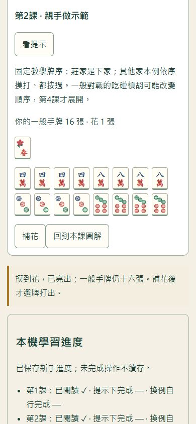

# S2.1：前三課入門試用版

2026-10-14（Asia/Taipei）。本機已完成，PR／main／正式發布核對待補。入口learn.html與[內容／保存契約](BEGINNER-LEARNING.md)；完整八課、真人理解及成效尚未完成。

## 本輪成果

| 課 | 示範與換例任務 |
|---|---|
| 認牌與桌面 | 六條→四筒；上家→下家的海底來源；東南西→中發白不能當順子 |
| 摸牌、補花與打牌 | 莊家由下家換上家；跟引擎完成16張摸花、亮春／梅、補17、選牌打16、確認下家。腳本其他人合法摸打且都按過，不是正常AI |
| 五組牌加眼睛 | 手選實體牌，收五組及眼睛、不重用牌；換例18張含一槓；找字牌連號與混花色連號反例 |

使用[learning-model.ts](src/learning-model.ts)調用凍結createGame／applyAction／legalActions及prepareHand／isWinningHand；不另寫一套行牌或胡牌算法。第三課只組牌型，不作當下能胡宣告。一般補花與無槓張數有明確條件，花胡例外未化約成一律補牌。

原六步導覽保留，首頁新連結直接進learn.html；不需解鎖對戰、練習或九題試讀。新頁沒有Session保存、沒有呼叫正式控制器；課程牆與組牌資料都固定標示教學。單擊／雙擊與Enter保留；收牌用原生按鈕，不做拖拉平台。操作時圖解收合，回看算提示；將任務帶到眼前，320px能看見組牌與主要控制。

本輪隔離Chrome／390px、合成示例截圖；不是真人理解證據。

## 進度與資料邊界

[learning-progress.ts](src/learning-progress.ts)只處理新鍵tw16:learn:v1，版本與4KiB／鍵名／三筆布林嚴格核對。已閱讀只表示按開始；提示下完成與換例本次未用提示／回看／錯答推導完成分列，不提供分數、證書或陌生題學習認證。固定題可重練、ARIA牌名可讀、本機值可編輯，不能當防作弊評量。

保存失敗保留記憶體及原檔，重試成功再標已存；未存有beforeunload提醒。只記閱讀及整段完成，中途操作不續存。Web Locks與expectedRaw串行核對，不支援鎖時不寫；其他頁更新停止覆蓋，放棄本頁新紀錄前確認。未知版／壞檔保留，重新建立須確認；清除等待時停用課程動作，避免寫入完成時丟掉其間的新紀錄。成功才重開圖解，失敗保留當前操作。

新增後五課須明定v1三筆遷移，不可直接改長度覆蓋。對戰v1、練習v1、檢討v2、試讀schema2及課題版本維持原契約。

## 驗證與限制

- 本機351項Node測試通過，新增9項涵蓋codec／容量／版本、旗標、鎖缺失／忙碌／配額／過期／等待捕捉、兩個引擎行牌示例、兩個實體組牌及反例。check／build成功；work/s21-unit.log。
- [learning.spec.js](test/e2e/learning.spec.js)與原四條核心回歸合計六條、兩視窗共12項；Chromium通過，Chrome155.0.8059.40與Edge155.0.4283.45也各12項通過。學習含示範／換例、回看與提示標記、三課重載、320組牌、舊存檔原字串不變；故障含配額保留／重試、未存重載取消、跨頁停止／取消與確認重讀、未知版重建取消／確認、禁止讀取。
- 最後補「清除等待時禁止課程動作」門檻；Web Lock暫停注入，確認禁止操作、釋放後空進度與操作恢復。最後四項Chromium／Chrome／Edge均通過，結果見HANDOFF與work/s21-learning-final.log、s21-chrome-learning-final.log、s21-edge-learning-final.log，不能把中途10/12當全部通過。
- Chrome隔離截圖檢查1440／390／320無橫向溢出；原生200%縮放組牌頁為720×450 CSS視窗、焦點可見、無橫向溢出。Chrome／Edge操作是headless自動驗收，非真人、觸控、螢幕閱讀器或手機Safari實機；不宣稱完整WCAG或普遍學習有效。
- 驗收資料均為合成；程式測試證明限定規則與操作，沒有不同專家審課或目標新手的理解驗證。S2.2需要真實形成性試用，不能以代理作答代填。

`npm test`／`npm run test:browser`沿用現有命令；指定已安裝Chrome／Edge方式見[S1.3](S13-VALIDATION.md)。沒有新依賴。額外4227檢視服務已關閉；4226由Playwright管理，瀏覽器與work/內的隔離profile已關閉，暫存檔Git忽略；真人存檔與Downloads未操作。

## 發布

Vite現在三入口index.html、training.html、learn.html；新增學習JS／CSS，共用view與引擎因使用而拆chunk。驗收要核對三份HTML引用的所有JS／CSS／modulepreload，不能沿用固定三資源假設。測試範例與文件不入site。PR／main與正式三入口及存檔隔離核對待補。

下一包S2.2形成性試用與修訂。無真人資料時準備任務／記錄方式並保留待驗，可推獨立S3.1九題修訂；不跳稱八課完整或學習成效已通關，不實裝人格AI。
