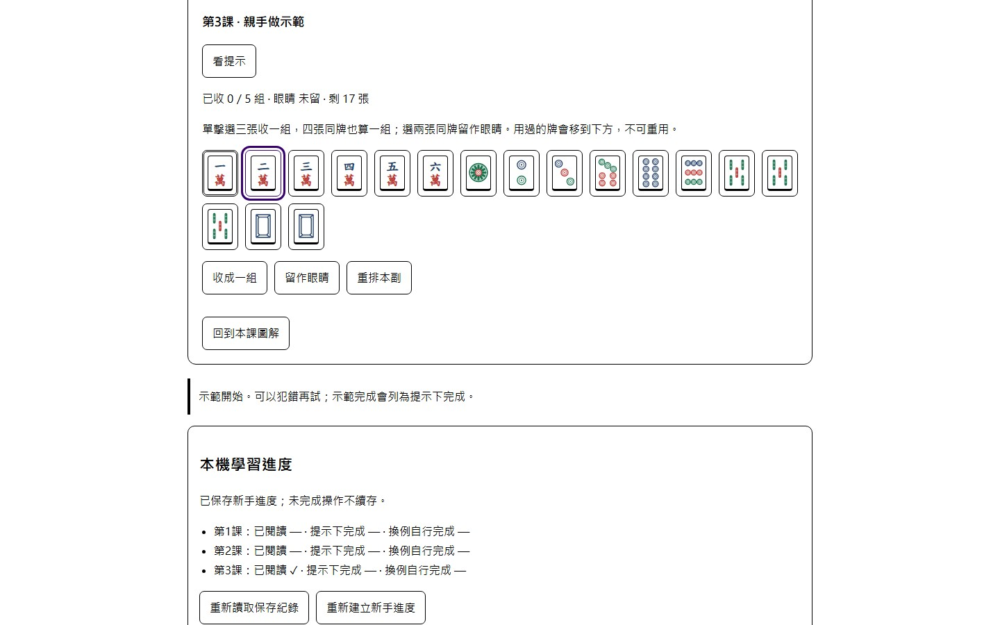

# S4.2：可及性與操作可靠性修正

2026-10-17。依已在隔離瀏覽器重現的缺口分包修正；當輪測試／提交／發布只記[HANDOFF](HANDOFF.md)。不代表手機、真人或螢幕閱讀器完整驗收，S4.2整體仍未完成。

## 重現與最小修正

1. 共用`tile()`把名稱放在一般span，SVG本身又隱藏；海底的可及性快照只有「左席 · 北」，沒有二萬圖片。給[共用牌面](src/view.ts)補`role=img`後，快照含「二萬，剛打出的牌」。首頁裝飾牌扇另標隱藏，避免增加沒有操作用途的朗讀；其他人暗手沿原遮蔽，暗槓只保留四張「暗牌」，不揭牌種。
2. 瀏覽器強制色彩會移除box-shadow並改用系統色；原本組牌選取的陰影／底色消失，選中與未選都是1px單線框。於[learning.css](src/learning.css)的forced-colors條件改用3px雙線ButtonText框；內距從7減5，保留按鈕原尺寸及獨立鍵盤焦點外框。只在該模式生效，不強行關掉使用者色彩偏好。

重現工具在未追蹤work/s42-forced-colors-audit.mjs及s42-tile-audit.mjs；before／after.log與修正前失敗trace分開保存。截圖是1440×900、Playwright Chromium模擬forced-colors的合成組牌示例，非作業系統對比主題或真人輔具驗收。

## 可重跑的回歸

[accessibility.spec.js](test/e2e/accessibility.spec.js)以實際頁面驗：

- 海底及最新打出牌可依圖片名稱取得，原始名稱在可及性快照可讀。
- 其他人暗槓只呈現四張暗牌，暗手牌背不增加朗讀，未把五筒洩露到該玩家快照。
- 純呈現變更沒有推進或改寫牌局，首頁裝飾牌仍隱藏。
- forced-colors的light／dark兩種瀏覽器色系，選取框和Tab焦點可分辨；按鈕尺寸不跳動，Shift+Tab及空白鍵可取消選取，窄畫面無水平溢出。

先在未修正版本跑兩個桌面任務，分別因找不到img及選取／未選框形狀相同而失敗，再修正；不是只寫會通過的樣式快照。檢查限定Chrome系瀏覽器的語意樹與CSS／鍵盤行為，不能代替實際螢幕閱讀器的語序、理解及操作。

在遊戲目錄建置後，`npx playwright test test/e2e/accessibility.spec.js`可重跑；全套沿既有命令。共用4230人工檢視preview與4226回歸服務分開；Chrome／Edge回歸需依次執行，不重用其他測試正在使用的4226。無新套件、規則／AI／資料格式變更。

判斷依據：[W3C非文字對比與元件狀態](https://www.w3.org/WAI/WCAG22/Understanding/non-text-contrast.html)、[MDN forced-colors行為](https://developer.mozilla.org/en-US/docs/Web/CSS/Reference/At-rules/@media/forced-colors)。這些是本包的設計依據，不是完整WCAG合規聲明。指定手機／Safari／輔具仍依[真人回饋清單](HUMAN-FEEDBACK-CHECKLIST.md)記錄，未取得資料不填通過。

## 新手進度重讀失敗：保留本頁紀錄與離頁提醒

前版按「重新讀取保存紀錄」會先重建空進度，loadProgress又先清dirty；如果讀取失敗、JSON壞掉或版本未知，就把尚未保存的本頁完成旗標及離頁提醒一併清掉。原存檔雖未改，本頁新完成的紀錄會失去。

[learning.ts](src/learning.ts)改先把讀到的原文放候選值，通過原本嚴格驗證後才替換progress並清dirty。失敗只停止覆寫，保留本頁進度與未存提醒；確認文案說明「重讀成功後」才放棄本頁未存紀錄。原文為未知／壞檔時仍不遷移，讀取失敗不假裝知道原檔；無新格式或新鍵。

[learning.spec.js](test/e2e/learning.spec.js)新增三種故障，各在桌面／窄畫面驗：先讓實際課程完成但寫入失敗，再重讀read-error／壞JSON／未知版本。三種均先重現原版清空問題；修後保留本頁完成、停用覆寫、原文不動，真實beforeunload仍可取消。修復原文或讀取後，再確認重讀才採用已存內容，重載及其他三類保存隔離亦核對。這是隔離合成故障，不是新真人試用資料。

## 對戰、練習與待存檢討的離頁提醒

前版對戰或練習寫入失敗只顯示保持頁面提醒，檢討也可能暫留待存佇列；重新整理沒有原生警告，會失去本頁尚未保存的變更。先在三種真實頁面流程重現：原檔仍在、重試按鈕出現，但beforeunload未取消。

[main.ts](src/main.ts)沿既有saveFailed／practiceSaveFailed與檢討pending判斷是否啟用原生beforeunload；畫面更新與非同步檢討完成時同步。只要仍有任一類未存內容便保留提醒，成功重試、後續成功保存或明確清除待存檢討後才依目前狀態解除。既有壞檔／未知版而沒有本頁新變更，不因此額外攔住重載。跨頁衝突不自動覆寫，使用者仍可確認離頁、重載最新存檔。

[play-save.spec.js](test/e2e/play-save.spec.js)在桌面／窄畫面分別驗對戰、純練習、待存檢討：配額失敗保留舊原文，取消真實重載保留16張手牌，恢復寫入後重試只保存當前狀態、不多打牌／摸牌；解除提醒後能正常重載並續局／續練。也核對另一種遊玩存檔及新手／試讀鍵原文不變。修前桌面三例均因缺少離頁防護失敗，trace與log保留於work/play-leave-before-evidence/及play-leave-before-tests.log。

不新增存檔鍵、格式、依賴或自訂確認視窗，不在離頁時臨時搶存資料；沿用明確重試。原生警告依賴瀏覽器及使用者操作，不能保證攔住手機關閉、程序終止或崩潰，亦不代表檔案已跨來源備份。

## 真正快取返回與跨分頁更新

2026-10-18補上可重跑的`npm run test:history -- chrome`／`msedge`。命令沿用Vite與Playwright，在隔離4231來源、全新headless context及合成資料依序驗對戰、純練習、新手進度、試讀保存；服務及context在成功／失敗後都關閉，不用日常瀏覽器profile。

原頁有已存紀錄時離開，由另一頁寫入合法的新版本，再返回上一頁。必須實際觀察`pageshow.persisted=true`才可通過，不能只看網址或把重新載入算成BFCache。原對戰／練習的舊17張手牌全停用，最新原文不變；課程能明確重讀新紀錄；試讀先停用覆寫、保留原頁理由，確認後才採用新理由。四類其他鍵均保持原文，頁面錯誤為0。

本機Chrome155.0.8059.80與Edge155.0.4283.62各四條通過。另以自有scratch副本刻意關閉BFCache，第一條以非零狀態及「未確實進入BFCache」拒絕；失敗亦關閉4231，未改正式腳本或玩家資料。

這是具名桌面驗證命令，沒有加入既有CI的核心回歸計數或改全域瀏覽器設定。本機預設Chromium headless shell未觸發真正快取返回；[Playwright官方文件](https://playwright.dev/docs/browsers#chromium-new-headless-mode)也區分shell與具名瀏覽器的headless模式。未進快取、未安裝具名瀏覽器或被企業政策停用時應報失敗／未驗，不能改成一般重載後填通過。未驗手機／Safari／真人輔具，不能宣稱所有快取情況已覆蓋。

## 三入口改版的跨畫面補驗

2026-10-18，對應[首頁](HOME-REDESIGN-20261018.md)、[試讀](TRIAL-WORKSPACE-20261018.md)及[前三課](LEARNING-LAYOUT-20261018.md)，建置與正式51f3577相符。另作一次性Chromium幾何／鍵盤檢查，涵蓋新斷點的兩側：寬320、390、540、541、760、761、900、901、1000、1001、1280、1440、1920；前十種高844，其餘高900。

每個寬度17狀態：首頁、續玩入口、續入深色牌桌、純練習、全部九道試讀、三課閱讀與組牌。合計221個檢查通過、0pageerror。每態核對頁面沒有橫向溢出，指定原生控制聚焦後在視窗內且中心可命中；資料均來自獨立context／合成牌例。沒有用測試去讀別家暗牌或更改學習紀錄的語義。

同一建置另以Chrome155.0.8059.80的全新暫存profile，在瀏覽器設定選原生200%放大：1440×900實體、720×450 CSS、devicePixelRatio=2。首頁、六步導覽、練習、九題、保存、離頁視窗、前三課閱讀、組牌與進度共19狀態，無橫向溢出，聚焦控制在視窗內且中心可命中、0pageerror。原始zoom-check.mjs／zoom-native-final.log與zoom-9Xip9x/result.json、截圖在work/entry-pages-20261018/；代表性首頁、組牌及離頁視窗已目視。一般Playwright截圖在此原生縮放產生捲動裁切異常，另以同一頁CDP原生畫面擷取核對，未為工具截圖問題改網站。這19項不計入CI52，不取代手機、Safari或真人輔具驗證。

此221項不加入CI52項，也不表示221張畫面皆逐張目視，更不是手機、文字放大、Safari或真人輔具驗證。當輪原始腳本／結果保留在根目錄忽略的`work/entry-pages-20261018/viewport-matrix.mjs`、`viewport-matrix.json`與log；沒有為此另加長期框架或新依賴。日常重跑仍以既有Playwright回歸為主，新增CSS斷點時再針對相鄰寬度補查。

## 入口補修：綠底文字與保存焦點

2026-10-18。Chrome155.0.8059.80正式建置實際computed style與Luna獨立計算均確認，首頁綠底對戰卡11px小標籤`#64765e`／`#eaf0e3`的比值為4.207749，低於一般文字4.5門檻。只對該卡標籤沿用既有muted色`#58695f`，實際提升至5.018787；白底兩卡原本4.842205保持。其他註記`#63705f`在綠底為4.502800，沒有把它誤判為失敗。依[W3C文字對比說明](https://www.w3.org/WAI/WCAG22/Understanding/contrast-minimum.html)用未取整數值判定；這是指定扁平底色文字核對，不是整站或完整WCAG檢查。

同時以真實鍵盤保存／清除試讀重現：busy停用原生按鈕後，操作完成焦點停在body、沒有焦點指示；下一次Tab仍到附近控制，未誇稱須從頁首重走。training.restoreStorageFocus只在焦點仍為body、原按鈕仍連在目前畫面時還原；若原控制已停用（如清除成功），回到管理summary。等待期間玩家移到理由欄或切題後不搶回。同步重讀原本就聚焦新題標題，維持該行為。

新增一條桌面／窄畫面鍵盤回歸（兩項）：成功保存、配額失敗保留原檔、延後鎖完成時仍保留新焦點與較新未存理由、清除後回管理summary。先在原版以toBeFocused失敗重現，修後連同原首頁／保存回歸14／14（10.6秒）；Chrome155.0.8059.80／Edge155.0.4283.62的新鍵盤兩項各通過（3.4／3.8秒），新總項目數54的指定CI依HANDOFF。沒有為純配色新增單元測試，保存鎖、資料版本及題目／答案未改。原始home-contrast-before／after.json、trial-focus-before.log、trial-focus-red.log、entry-polish-browser.log與trial-focus-chrome／msedge.log在work/entry-pages-20261018/。

[PR#28](https://github.com/zhai2Liu/taiwan-mahjong/pull/28)來源9454dae，Actions39068777950成功400／54（52.7秒），合併9784777；main39068956795成功400／54（51.5秒）與Pages成功。正式三頁及全部引用資源相符，Chrome1440／Edge390的實際新色、鍵盤保存／清除回焦、保留頁內理由及其他鍵、0pageerror均通過，詳HANDOFF與entry-polish-live-*。不因這兩項修正宣稱完整輔具或真人驗收已完成。
