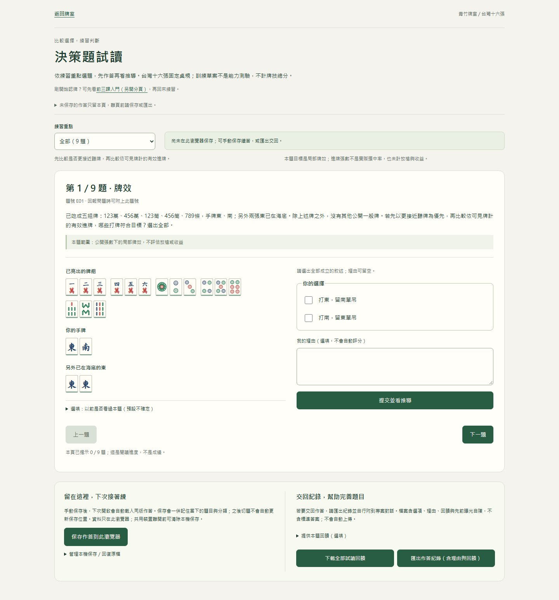
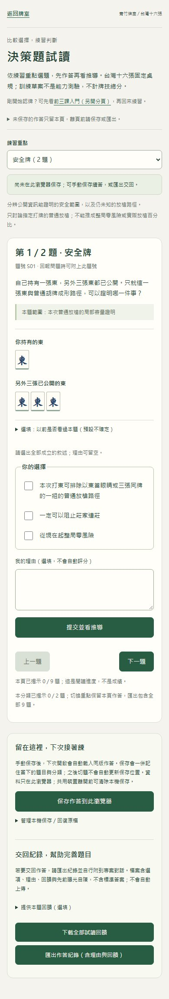

# 試讀頁的牌例、作答與保存位置

2026-10-18｜S1.5。承接[首頁重設計](HOME-REDESIGN-20261018.md)，整理既有九題試讀的資訊層級；不是新題庫或正式評量。[PR#23](https://github.com/zhai2Liu/taiwan-mahjong/pull/23)來源9a35c35、CI39065728154成功400／52，已合併並發布e760702；main39065890220成功400／52（44.0秒）及Pages，正式三頁資源及Chrome／Edge作答、保存／重載／匯出與取消離頁通過。最新版本仍依[HANDOFF](HANDOFF.md)。

## 調整

原頁面將介紹、分類、題幹、牌例、選項、保存與下載一路堆疊。現在以同一套暖白／深綠色系區分：

1. 頁首：返回牌室、試讀定位、新手入口與離頁保存說明。
2. 練習重點及本機保存狀態；能力目標與限制保持可見。
3. 本題：題號、完整題幹與範圍；桌面將已知牌例和作答並排，900px以下照閱讀順序直列。
4. 保存／交回：本機續答與匯出回饋各一區，沒有新增自動上傳或離頁阻擋。

沒有隱藏安全條件、刪題幹或縮減完整匯出。空牌例的局況題直接提示依題幹作答，不虛構完整手牌。尚未揭示答案前仍可填理由，揭示後不能重做選擇或變更曝光自陳。

保存文案明寫「按下保存時的題目與分類」；之後切題不自動更新保存位置，也不把單純導覽變成未保存作答。這符合[S3.3](S33-VALIDATION.md)的手動快照契約。

## 畫面

截圖為隔離瀏覽器的合成資料，沒有真人作答；不可用來宣稱手機實機支援或學習成效。

## 維護與驗證

變更限定 `training.html`、`src/training.ts` 的 render 組合及 `src/training.css`。保留 `question-heading`／`answer` 焦點、既有保存與匯出ID、事件監聽及原生離頁視窗。本機Node400／400、型別／正式建置及Chromium52／52（40.6秒）通過；另外指定Chrome／Edge各四項九題排版與真實匯出／離頁流程通過。最後提交CI／正式核對依HANDOFF。

`test/e2e/trial-layout.spec.js`巡覽全部九題，核對桌面並排／窄畫面直列、320px無橫向溢出、原生選項鍵盤焦點可命中且未被勾選、導覽不自動保存。既有回歸繼續核對分類保留、揭示鎖定、真實匯出、保存失敗／跨頁／重讀與離頁保護。

沒有修改 TRAINING JSON、內容版本生成器、標準答案、曝光、保存格式、判題、規則、AI或學習進度。Luna僅做限定唯讀差異審查；未替代實際測試或人工題意審核。原始前後畫面與logs在忽略的根目錄 `work/entry-pages-20261018/`。
