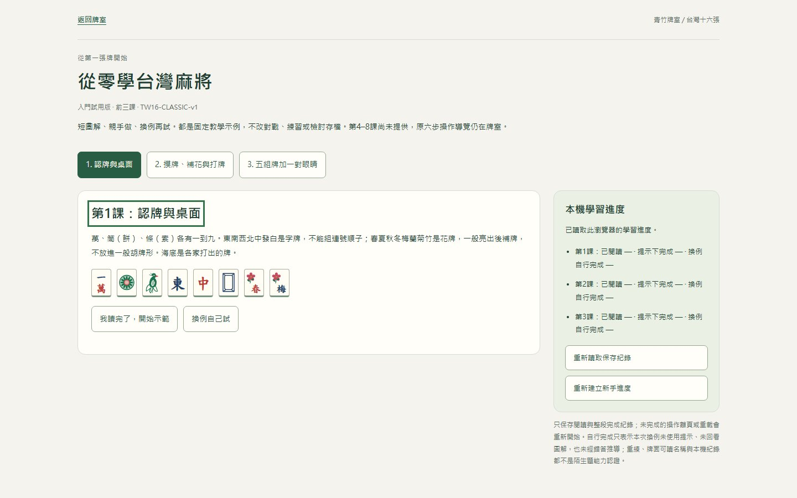
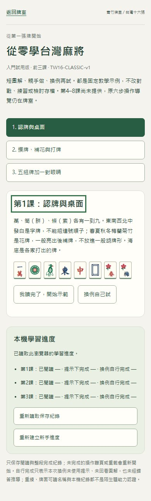

# 前三課任務與學習進度排版

2026-10-18｜S1.6。接[首頁](HOME-REDESIGN-20261018.md)與[試讀工作區](TRIAL-WORKSPACE-20261018.md)的視覺整理，限定現有前三課；完整八課與真人驗證仍依原關卡。[PR#24](https://github.com/zhai2Liu/taiwan-mahjong/pull/24)來源80f7546、Actions39066375904成功400／52（52.0秒），已合併並發布51f3577；main39066578543成功400／52（50.7秒）、Pages與三頁資源核對通過。正式Chrome／Edge教學完成、組牌、三筆v1進度重載及其他鍵保留通過。最新版本依[HANDOFF](../../HANDOFF.md)。

桌面將課程任務與獨立學習進度並排，讓玩家同時看見正在做的事及已保存的紀錄；1000px以下回到任務→回饋→進度的閱讀順序。頁首品牌、返回入口、暖白／深綠色彩與其他入口一致。初始空回饋保留在DOM，只移除空白底色與邊線；有訊息時仍可聚焦與播報。

只改 `learn.html` 與 `src/learning.css`。`learning.ts`、課文／示例／答案、`tw16:learn:v1` 的三筆進度及其他保存鍵均未改。nav的`aria-current=step`、互動牌的`aria-pressed`、課程標題與回饋焦點、status/live區均保留。強制色彩仍以3px雙線和5px內距補償普通1px邊線／7px內距，不能讓選取牌突然變大。

本機型別／正式建置與既有learning／accessibility **16／16**（16.0秒）通過；沒有為靜態排版加算法測試。包含三課示範與換例、含槓組牌、提示標記、320px、亮暗強制色彩及失敗／壞檔／跨頁／重讀保留。最後微調標題焦點框後，再以具名Chrome／Edge各六項核對三課與強制色彩。實際結果依HANDOFF；不等同手機／Safari／真人輔具或理解驗證。

`work/entry-pages-20261018/learning-*`保留原始截圖及logs，均為隔離來源與合成資料。Luna只作限定唯讀HTML／CSS契約審查，不代替執行或真人資料。
