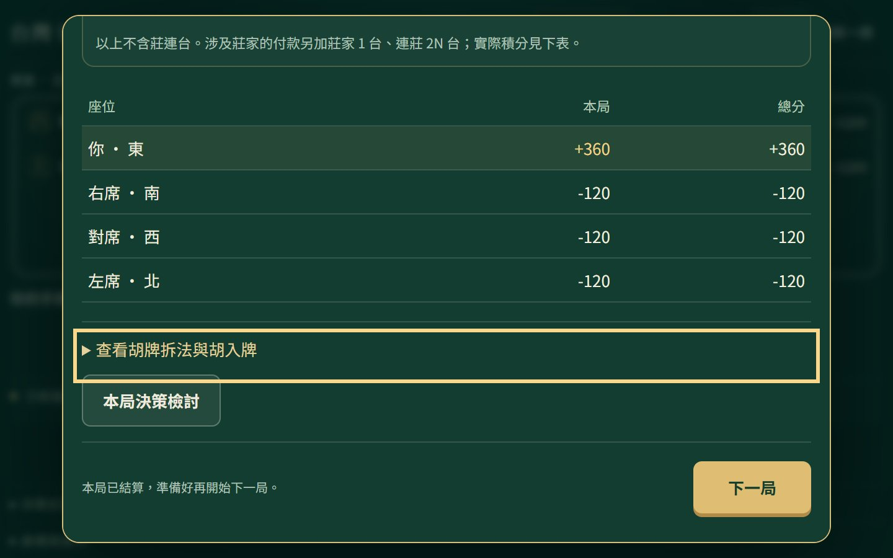

# S1.3：操作焦點修正、支援範圍與效能基準

2026-10-14（Asia/Taipei）。本機、PR／main與發布核對完成；最新狀態見[HANDOFF](../../HANDOFF.md)。未改TW16-CLASSIC-v1、遊戲AI、存檔、題庫與匯出版本。

## 問題與修正

結算底部固定「下一局」區域遮住鍵盤焦點：390×844／320×844，從結算標題按Tab，依序到返回、胡牌拆法、檢討；後兩項中心點被result-footer或其文字蓋住。這不是付款錯誤。

[style.css](../../src/style.css)增加`scroll-padding-block-end: 6rem`，讓瀏覽器將焦點捲到固定底部之上，保留原生dialog。註解明示上限：目前footer的高度預留；若新增底部控制，改獨立內容／footer兩列，不繼續猜測高度。

[core.spec.js](../../test/e2e/core.spec.js)加入真實Tab與命中檢查，結算1440／390／320的拆法及檢討控制取得焦點且中心點未被遮住；Enter開檢討、關閉回原控制，不重付。新增練習鍵盤選牌／出牌／摸牌／返回與320px存檔隔離。現在四條路徑、桌面／窄畫面各一次，共八項。



本輪合成牌例、本機Chrome原生200%縮放（1440×900實體截圖，720×450 CSS視窗）。檢查依據：[焦點不被遮住](https://www.w3.org/WAI/WCAG22/Understanding/focus-not-obscured-minimum.html)、[文字放大](https://www.w3.org/WAI/WCAG22/Understanding/resize-text.html)。不代表完整WCAG認證。

## 已驗與未驗環境

Windows 11專業版10.0.26200、AMD Ryzen 5 9600X、Node24.12.0，使用隔離context，不讀日常瀏覽器profile。

| 瀏覽器 | 本輪已驗 |
|---|---|
| Playwright Chromium 156.0.8078.4 | 八項回歸通過；1440×900／390×844，結算與練習另驗320寬 |
| Chrome 155.0.8059.40 | 同八項通過；獨立暫存profile由瀏覽器設定切原生200%，首頁／對戰／練習／結算／試讀無橫向溢出，結算焦點未遮；reduce設定下實際聽牌回饋animation為none |
| Edge 155.0.4283.45 | 同八項通過；原生200%未另驗 |
| Android Chrome、iPhone Safari、Firefox、螢幕閱讀器 | 未驗，不承諾完整支援 |

為實際安裝瀏覽器的headless自動操作與截圖檢視，不是手機、觸控、真人或人工有視窗全流程驗收。初次掃描1440／390／320的首頁、密集牌河、練習及試讀無橫向溢出；練習轉換焦點正常。完整功能覆蓋仍依引擎、控制器與歷史故障證據，不由八項推論零缺陷。

342項Node測試、check／build通過；Chromium八項7.2秒、Chrome八項8.2秒、Edge八項8.7秒是當次測試耗時。日誌work/s13-unit.log、s13-chrome-tests.log、s13-msedge-tests.log。測試服務與額外4227檢視服務已停，所有本輪瀏覽器／profile已關閉；work/暫存檔保留且Git忽略。

## 效能方法與結果

[browser-baseline.mjs](../../scripts/browser-baseline.mjs)沿用Playwright、Vite，管理獨立4228 preview與瀏覽器生命週期，沒有新依賴。固定feedbackReady公開牌例、1440×900、reduce；程序暖身一次，再九個全新context，無存檔／HTTP快取延續、不節流。OS、程序與server快取未清冷，不稱真實冷啟動。

[原始樣本與環境](../../S13-PERFORMANCE.json)保留產物名。中位數為排序中間值，p90為nearest-rank；九筆p90等於最大值，樣本小、不推論普遍效能。

| ms（中位數／p90） | Chrome | Edge | 同場景調查門檻（p90） |
|---|---:|---:|---:|
| 載入至首頁可操作 | 112.7／121.9 | 101.6／107.2 | 1,000ms |
| 單擊選牌至兩次繪圖回呼 | 29.3／29.7 | 29.6／29.9 | 100ms |
| 第二擊至解釋顯示與兩次繪圖回呼 | 64.3／80.3 | 64.6／64.9 | 300ms |
| Node公開觀測與完整候選分析 | 9.03／12.12 | 9.18／12.6 | 100ms |

載入為navigationStart至定位器確認可用；選牌／解釋為捕捉事件至兩次requestAnimationFrame，含自動化確認／排程開銷，不是純算法、INP、FCP或LCP。Node分析每次重新建立decision內cache；兩欄是兩次主機量測，不能當瀏覽器算法比較。loopback不代表Pages行動網路。

門檻只是同環境／同牌例的調查起點，不是全裝置SLA或CI硬性時間閘門。反覆超過門檻或既有p90兩倍，再增加樣本／場景、定位耗時；本輪不需要worker／全域快取重構。

## 重跑方式

於遊戲目錄：

```powershell
npm ci
npx playwright install chromium
npm run test:browser
# 已安裝Chrome／Edge的隔離回歸，不使用日常profile：
$env:TW16_BROWSER_CHANNEL = 'chrome' # 或 'msedge'
npx playwright test
Remove-Item Env:TW16_BROWSER_CHANNEL
# build後，stdout為JSON：
node scripts/browser-baseline.mjs chrome
node scripts/browser-baseline.mjs msedge
```

`npm run benchmark:browser -- chrome`先build再量測；省略channel用Playwright Chromium。Chrome／Edge需要實際安裝；4228已占用即拒絕，不借用他人服務。CI跑功能回歸；效能與已安裝channel按需重跑，不將主機速度差異當功能失敗。

## 發布與下一包

來源1576c48的[PR#4](https://github.com/zhai2Liu/taiwan-mahjong/pull/4)已合併1ca8a18；[PR Actions38547430937](https://github.com/zhai2Liu/taiwan-mahjong/actions/runs/38547430937)成功，342／八項（Linux 8.1秒）通過、Pages上傳與deploy skipped、0 artifact；[main Actions38547636980](https://github.com/zhai2Liu/taiwan-mahjong/actions/runs/38547636980)的342／八項（11.2秒）、build與deploy均成功。沒有外部真人程式審查，未設定分支保護強制門檻。

正式首頁／training.html均HTTP200，各自引用三份JS／CSS的SHA-256與本機一致（work/s13-live.log）。隔離Chrome合成結算在正式站390／320，實際Tab到拆法及檢討的中心命中均可見（work/s13-prod-focus.log），瀏覽器已關閉；未操作真人存檔。

正式產物index-pavZUWLg.js／index-BTGPI-3-.css；試讀training-CyxzesHo.js／training-DnepUIbB.css、共用tile-face-CG76dTyt.js不變。遊戲JS內容雜湊未變，檔名隨CSS參照圖更新；測試頁、工具、JSON與截圖不入site。

下一包S2.1：前三課最小可操作教學與必要進度，先定教學隔離、版本與保存契約，再接畫面。手機／Safari與真人驗證留S4，不用本輪自測代填；人格AI仍需另行啟動。
